# F4 catalogue, reference data and price lists

- **Session:** F4, on branch `f04-catalogue`, off `main` (F0 to F3 are merged). Stacked PR base: `main`.
- **Date:** 2026-11-15
- **Gate:** **met against the mock.** A price list change can be previewed before it activates: `e2e/specs/console/catalogue.spec.ts` ("the F4 gate") opens a draft, reads each line beside the same line in the version in force, changes a line, submits, and sees "Nothing has changed yet".
- **Task 1, F3's real-API gate: UNMET, attempted.** Carried to F5 as task 1, unchanged.

## Assumed this session (all dated 2026-11-15, in docs/ASSUMPTIONS.md)

| Id      | Assumption                                                                                                                                                                            |
| ------- | ------------------------------------------------------------------------------------------------------------------------------------------------------------------------------------- |
| A-F4-01 | F3's real-API gate is unmet: no backend checkout, no `HK_API_BASE_URL`, the proxy refuses the staging and production API hosts.                                                       |
| A-F4-02 | The preview lines draft and in-force versions up by product, grade, band and quantity break; it compares, never computes; 500 lines each at most, then words and no preview (CR-009). |
| A-F4-03 | A start day is sent as `YYYY-MM-DDT00:00:00Z`: Accra is UTC+0 with no daylight saving.                                                                                                |
| A-F4-04 | A draft's lines can be changed or dropped; adding a line is not built yet. A new draft copies the version in force.                                                                   |
| A-F4-05 | Units are read only; the contract has no unit writes or conversions (CR-011).                                                                                                         |
| A-F4-06 | Floor, list and ceiling order and weight band overlaps are the server's rules; forms show its 422 on the field.                                                                       |
| A-F4-07 | Price list lines are shown once per id (the harnesses' last page repeats Prism's example rows).                                                                                       |
| A-F4-08 | F4 screens and the `catalogue` namespace load on demand (ADR 0032, proposed).                                                                                                         |
| A-F4-09 | The new product form covers the contract's required fields plus species, pack weight, barcode and description; the rest are server defaults.                                          |
| A-F4-10 | Creating a price list, assigning one to a customer and approving a version are not F4 screens.                                                                                        |
| A-F4-11 | The test owner holds the catalogue permissions but not `mdm.price_list.approve`.                                                                                                      |
| A-F4-12 | Screenshots come from the production build on the mock through the e2e fake, signed in as the owner.                                                                                  |

## Task 1: the deferred real-API half of F3's gate

| Check                                                            | Outcome                                                                                          |
| ---------------------------------------------------------------- | ------------------------------------------------------------------------------------------------ |
| `./scripts/sync-contract.sh`                                     | Failed: `../backend/contract/openapi.yaml does not exist`. This container has only the frontend. |
| `HK_API_BASE_URL`                                                | Unset; no B3 address was given.                                                                  |
| `curl https://api.staging.hakoremfarms.com/v1/auth/session`      | `CONNECT tunnel failed, response 403` from the environment's proxy.                              |
| `curl https://api.hakoremfarms.com/v1/auth/session`              | The same.                                                                                        |
| Sign-in as owner and cashier, denied pages, step-up, CSRF origin | **Not run.** No real API reachable.                                                              |

The gate is **unmet, not skipped**. Task 2 (issue #4) depends on it and was not started. Both go to F5's opening message unchanged.

## Built

All routes are in `apps/console/src/app/routes.tsx`, loaded on demand (ADR 0032). Each route's permission is the `x-permission` of the operation it reads, or writes for a form.

| Route                      | Screen                                                                                       | Permission            | Writes                                                               |
| -------------------------- | -------------------------------------------------------------------------------------------- | --------------------- | -------------------------------------------------------------------- |
| `/products`                | Search by name, SKU or barcode; status filter; cursor pages                                  | `mdm.product.read`    |                                                                      |
| `/products/new`            | New product, stock policy explained; dirty guard                                             | `mdm.product.create`  | `createProduct`                                                      |
| `/products/:id`            | Stock-keeping facts; details form (changed fields only, `version`, 409 reload); archive      | `mdm.product.read`    | `updateProduct`, `archiveProduct` (reason)                           |
| `/categories`              | Categories with line, tax category, online flag; create and change in a dialog; archive      | `mdm.category.read`   | `createCategory`, `updateCategory`, `archiveCategory`                |
| `/units`                   | Units, read only                                                                             | `mdm.product.read`    |                                                                      |
| `/species`                 | Species with grade and band counts                                                           | `mdm.species.read`    |                                                                      |
| `/species/:id`             | Grades and weight bands of one species, each created, changed and archived in place          | `mdm.species.read`    | `createGrade`, `updateGrade`, `archiveGrade`, and the same for bands |
| `/price-lists`             | Price lists by kind, what each applies to, the version in force, a link to any draft         | `mdm.price_list.read` |                                                                      |
| `/price-lists/:id`         | Versions with their dates and states; draft the next version (copied from the one in force)  | `mdm.price_list.read` | `createPriceListVersion`                                             |
| `/price-list-versions/:id` | **The gate.** Preview of a draft against the version in force; change or drop a line; submit | `mdm.price_list.read` | `replacePriceListEntries`, `submitPriceListVersion` (202 handled)    |

- **Four states on every screen**, through `QueryBoundary`; a record's 404 is "not found". 44 integration tests on the real Prism prove them (four per screen, plus four gate writes).
- **Failed writes leave words:** `WriteFailureView` on forms (409 offers a reload), `MutationFailure` in dialogs.
- **Money and weight:** prices through `PriceBandDisplay` and `MoneyInput` in integer pesewas; bands through `WeightDisplay` and `WeightInput`, three places. The preview's comparison (`pricing/preview.ts`) has six unit tests and asserts exact pesewa values pass through untouched.
- **A write to money asks first:** submitting shows the change counts and the start time in a dialog.
- **New in the console:** `lib/approval.ts` (`isApprovalPending`, telling a 202 body from a record). **No new `packages/ui` component**, stylesheet, provider, context or variant mechanism.
- **Sidebar:** Categories, Units, Species, grades and bands, and Price lists, each shown only with its permission.

## Checks at the tip

Each run on its own, exit code recorded.

| Check                                                       | Exit | Result                                                                |
| ----------------------------------------------------------- | ---- | --------------------------------------------------------------------- |
| `format:check`, `lint`, `typecheck`                         | 0    |                                                                       |
| `tokens:check`, `fonts:check`, `icons:check`                | 0    |                                                                       |
| `sync-contract:check`                                       | 0    | committed client matches contract 1.1.0                               |
| `test:unit`                                                 | 0    | console 144 (was 136); the other packages unchanged                   |
| `test:integration`                                          | 0    | 106 (was 62)                                                          |
| `build:console` (`HK_API_BASE_URL=/mock`), `budget:console` | 0    | back office 269.2 of 300 kB initial (was 266.1); till 195.7 of 250 kB |
| `test:e2e`, full, 3 workers                                 | 0    | 156 passed (was 125; 31 new in `catalogue.spec.ts`)                   |
| gate and create-product specs, `--repeat-each 2`            | 0    | 4 passed                                                              |
| `pnpm screenshots` (F04)                                    | 0    | 20 shots                                                              |

Not re-run, because nothing they read changed: `test:a11y` and `build-storybook` (no `packages/ui` change).

**Environment note:** this container's Chromium is build 1243 and the repo pins Playwright 1.64.1 (build 1248). Playwright ran through an untracked `e2e/playwright.local.config.ts` that sets `executablePath: /opt/pw-browsers/chromium`. Nothing committed depends on it.

## Decided

- **ADR 0032 (proposed):** back office feature screens, and their words, load on demand through the existing `lazyScreen`. Reversible; the owner may prefer eager screens and a larger budget.

## Screenshots

Production build on the mock, signed in as the owner, light theme. The preview's version in force is rewritten for the shot exactly as in the gate spec (CR-010).

**Price list version: the gate.** The draft beside the prices in force, with what changes counted.

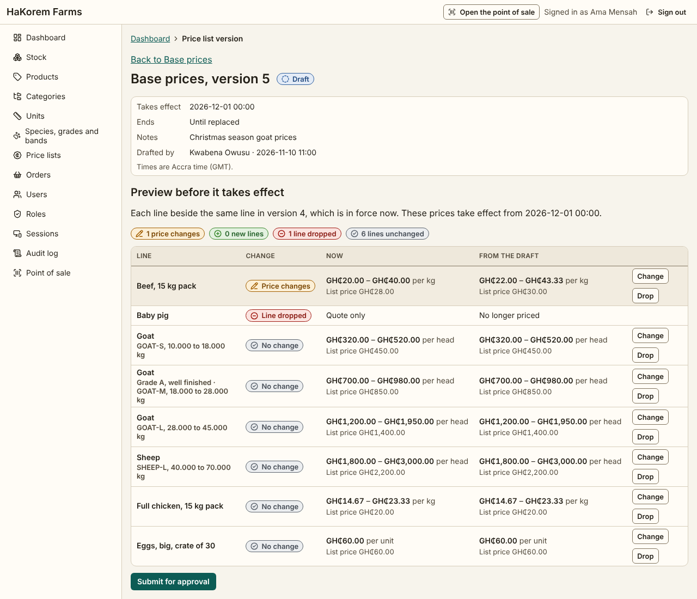 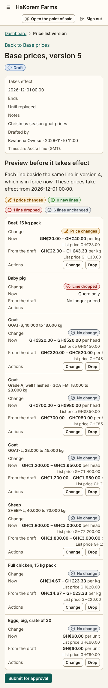

**Price lists.** Each list, what it applies to, the version in force and a link to its draft.

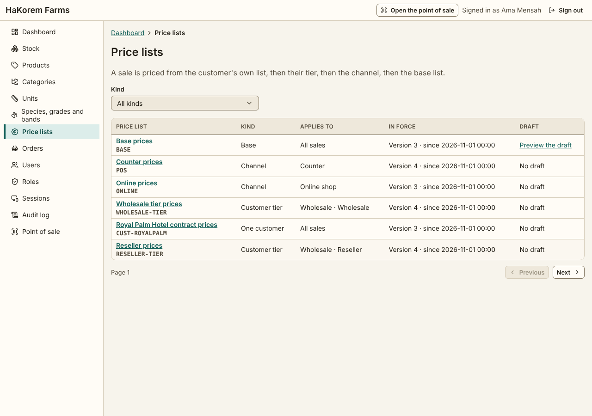 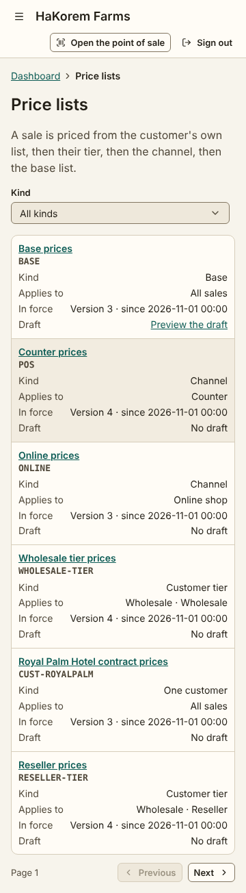

**Price list.** Versions with their dates and states.

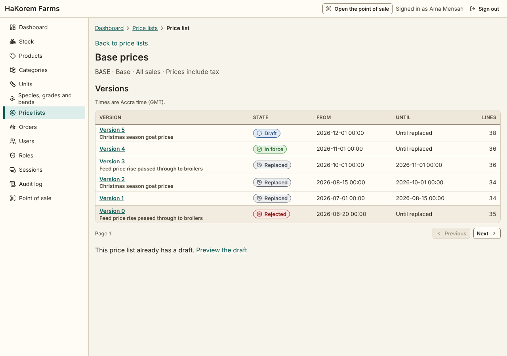 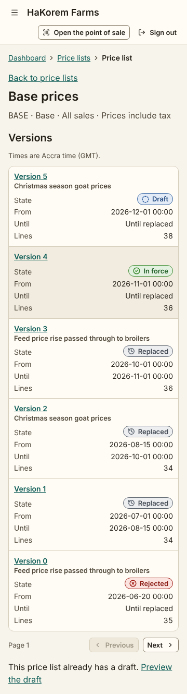

**Products.** Search, status filter and the table, stacked at 360 px.

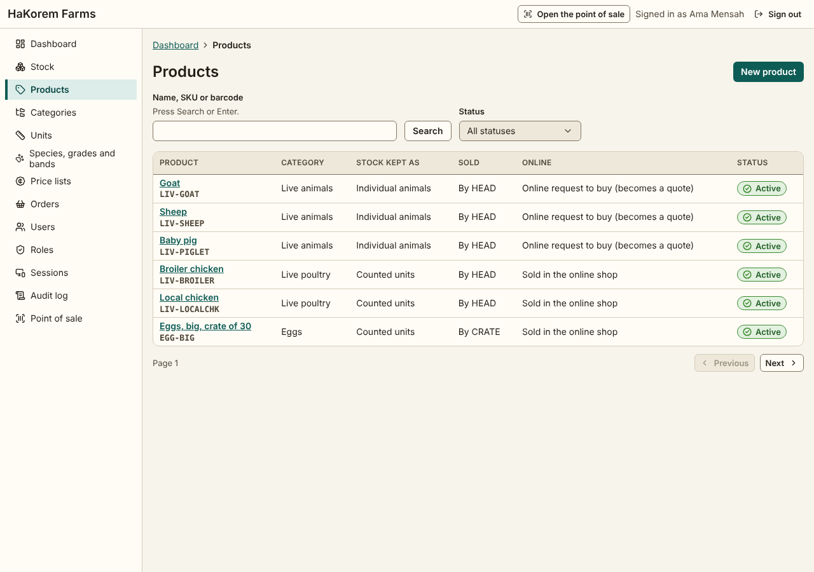 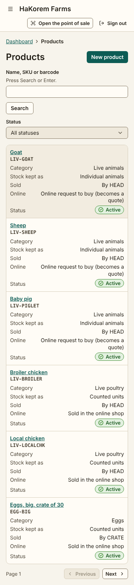

**Product.** Stock-keeping facts, the details form and archiving.

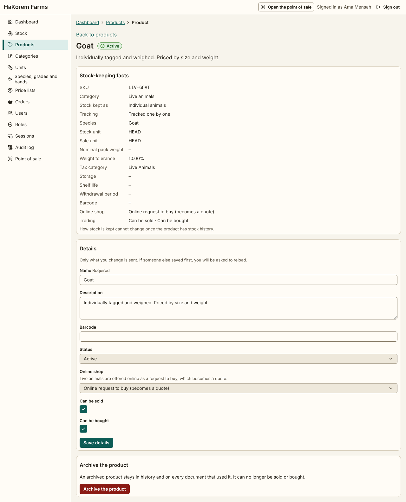 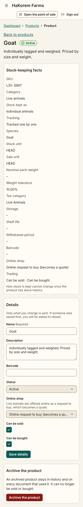

**New product.** The form, with how stock is kept explained.

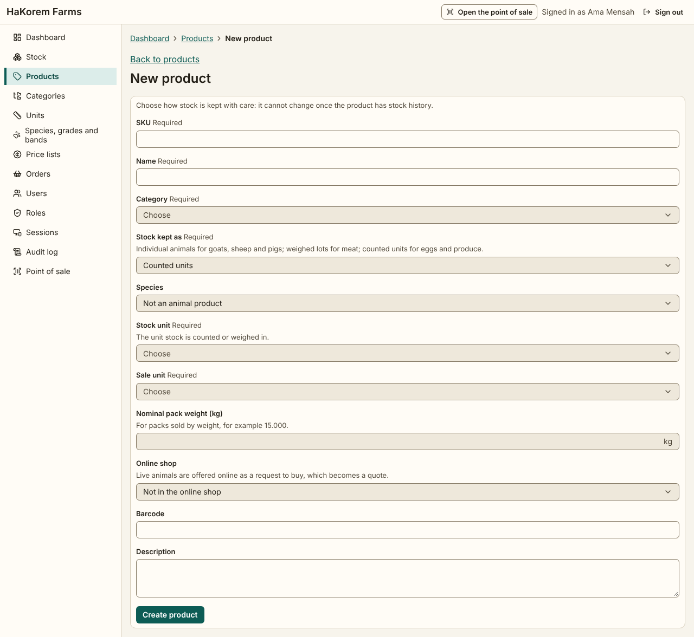 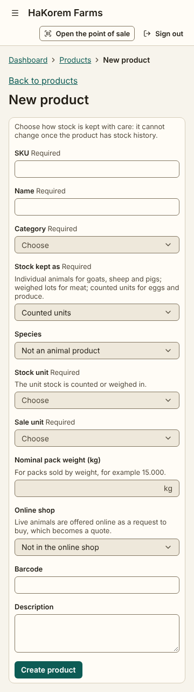

**Categories.** Line, tax category and online visibility, with change and archive.

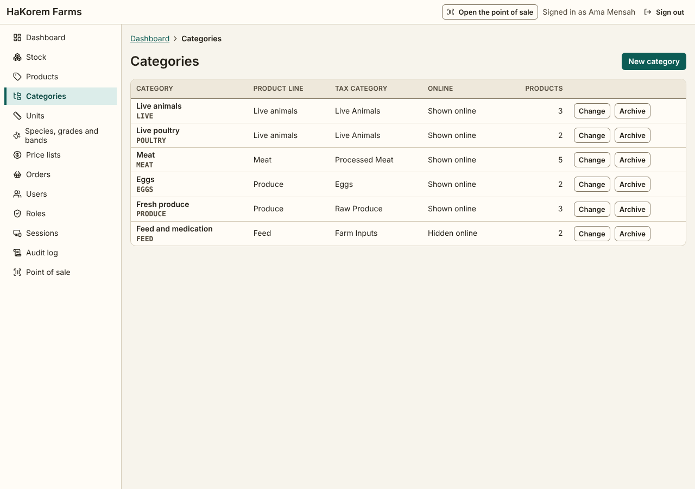 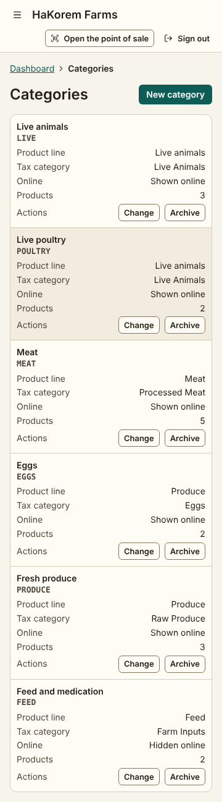

**Units.** Read only.

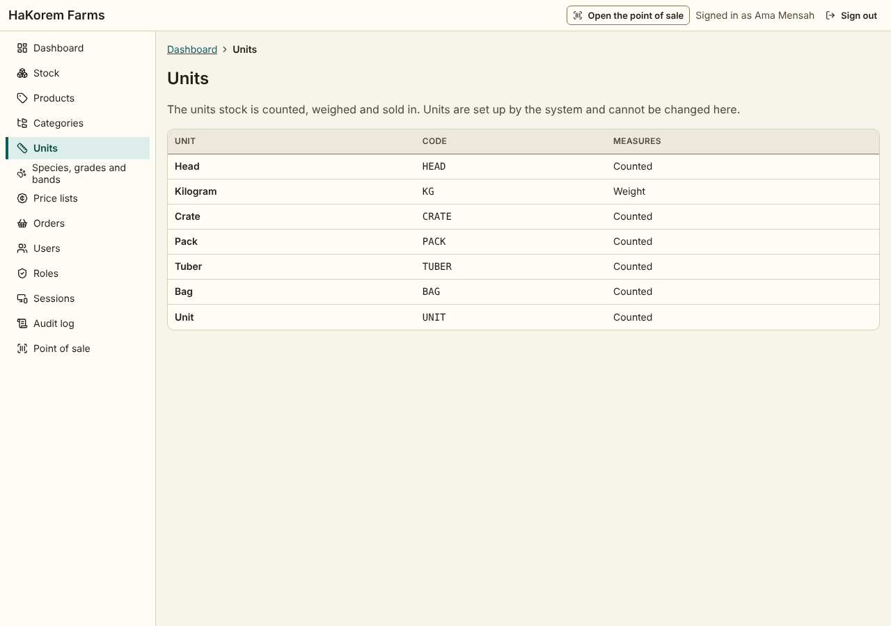 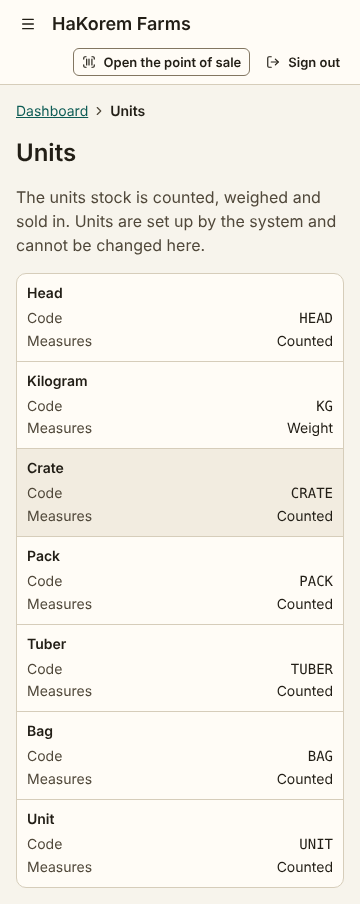

**Species.** Each species with its grade and band counts.

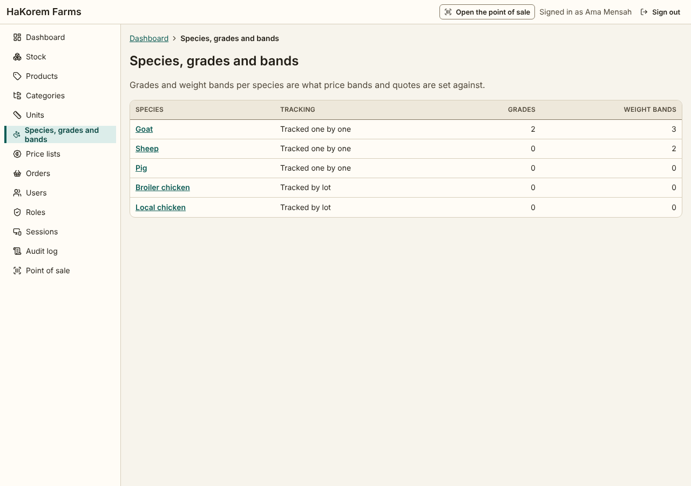 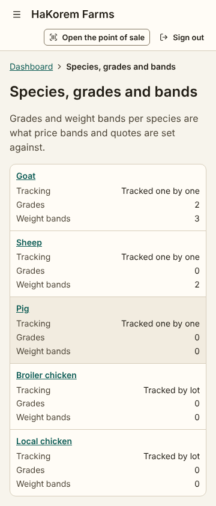

**Goat.** Its grades and weight bands.

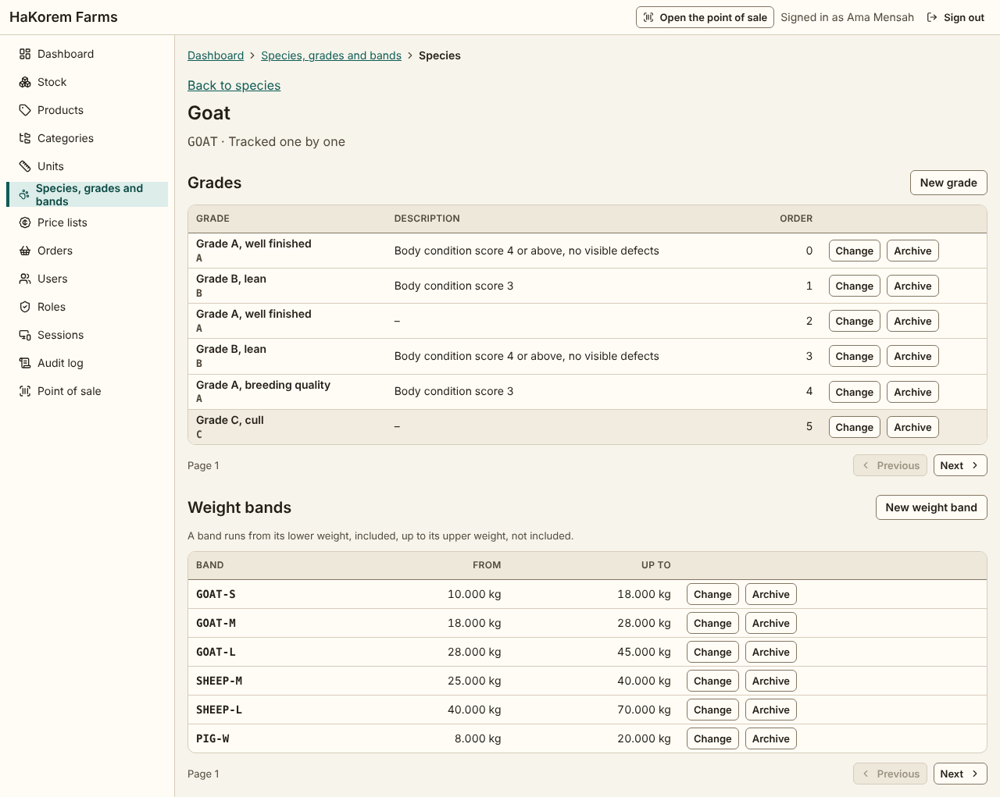 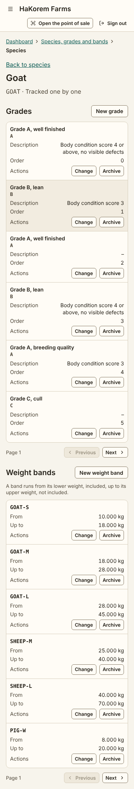

## Not verified, and said plainly

- **Nothing against a real API** (task 1).
- **Approval of a submitted version** is the approval queue's job and is not built; the 202 path is proved against Prism's own 202 example.
- **Prism ignores filters:** `listGrades?speciesId=` and `listWeightBands?speciesId=` return every species' rows against the mock, so the goat page lists sheep and pig grades. The real API filters.
- **No human looked at the screens** beyond the screenshots above.
- **CI has not run remotely** on this branch.

## Contract

- **Synced:** not possible (no `../backend`). The contract is still 1.1.0.
- **Screens moved from the mock to the real API:** none. No backend module is reachable.
- **Added to `docs/CONTRACT_REQUESTS.md`:** CR-009 (a server-side preview of a draft against the version in force), CR-010 (the price list examples contradict each other), CR-011 (units: conversions and writes).
- **Still open:** CR-001, CR-003 to CR-008.

## Opening message for F5

```text
Read CLAUDE.md, docs/SHARED_BRIEF.md, and the F5 row of the screen sessions table in
docs/BUILD_PROMPT.md. Read docs/DATA_CONVENTIONS.md. Read only the most recent report in
docs/sessions/ (F04-catalogue.md). Do not reopen decisions in docs/adr/ (0001 to 0032).

You are on a branch created off f04-catalogue.

TASK 1 (REQUIRED, first): the deferred real-API half of F3's gate, unchanged from F4.
- Point HK_API_BASE_URL at the B3 API. Sign in as an owner and as a cashier.
- As the cashier, confirm the denied state in words, on the same URL, on /users, /roles,
  /sessions and /audit. Check step-up and the CSRF origin rule against the real server.
- If the real API cannot be reached, attempt it and record what you tried: UNMET, not
  skipped. Carry it to F6 as task 1.
TASK 2, only if task 1 passed: issue #4.

Then F5: stock on hand, goods receipt, transfers, adjustments with reason codes, stock take.
The gate: a storekeeper completes a stock take on a phone, standing in the cold room. Read
CR-001 and CR-003: build against a local mock override with exactly their field names until
the contract carries them. Every write to stock confirms with the exact quantities first.

F5 screens load on demand with their own namespace (ADR 0032). After the gate, run
pnpm screenshots for F05 and embed them in the report.
```
