# F7: the storefront: catalogue, search, product pages, basket, checkout and delivery slots

- **Session:** F7, on branch `claude/wonderful-cray-694wra`, from `main` at `035f736` (F6b merged).
- **Date:** 2026-11-16
- **Scope:** the F6b report's opening message, and the owner's two additions:
  1. answer contract 1.29.0 to 1.39.0 first: B06r's approval for processing reversals (CR-025), CR-023 and CR-026;
  2. F7 as BUILD_PROMPT describes it: catalogue, search, filters, product detail, cart, checkout and delivery slots;
  3. **the owner's additions:** review the storefront's look (it should read as a farm shop selling fresh meat, eggs and live animals, and feel fast on a cheap phone), and put screenshots of every storefront page at 360 px and 1280 px in this report.
- **Gate:** checkout completes on a throttled 3G connection, and the catch-weight estimate is unmissable. Re-measure the storefront budget.

## The gate

- **Checkout completes on throttled 3G.** An e2e spec goes from a product page to a placed order at 300 ms round trip, 700 Kbps down and 4x CPU, the brief's cheap-phone floor: add to basket, open the drawer, checkout, details, delivery checked, a slot, the hold, pay. It passed in every full run (12 s from product page to placed order, including the test typing the details, in each of three runs).
- **The catch-weight estimate is unmissable.** A weighed item says how it is charged in three places, each asserted:
  - **on its card** in a listing: "Priced by weight: you pay for what it weighs", and what a unit weighs;
  - **on its page,** beside the price, in a notice with a thick accent edge and the scale icon (`CatchWeightNotice`): the price per kg, what a pack weighs, how much more it can weigh, and the API's own rule. At 360 px the spec asserts the notice starts in the first screen;
  - **at checkout,** the total is titled "Your total is an estimate", with the most that can be charged beside it and the API's `finalChargeRule` in its words. The pay button names the exact amount.
- **The budget, re-measured** on the real listing page (below and in `docs/PERFORMANCE_BUDGET.md`). The largest paint is under 2.5 s on the same 3G profile (about 1.26 s on `/c/meat`, in each of three runs). The page is 357 KB with its photographs, over the brief's 300 KB; the cut that brings it under is the owner's decision (below, "For the owner").

## First: the contract, 1.28.0 to 1.39.0

Synced with `pnpm sync-contract:github`: backend `b3b0db8`, contract 1.39.0, 635 operations. The console stopped compiling, as it should, on one new status. Answered first:

- **1.31.0, B06r, processing reversals under approval (CR-025, built).** `cancelProcessingOrder` on a completed order may answer 202 `PROCESSING_REVERSAL` at or above the threshold.
  - The order page says the reversal waits for a second person and that nothing has moved, instead of "reversed".
  - It shows `pendingReversal`: who asked, when, why, its value against the threshold, and a link to the request. It stops offering the reversal while one waits.
  - A posted reversal names who approved it.
  - An integration test drives the 202 through Prism.
- **1.31.0, deaths.** `MortalityRecord.status` gains `RETURNED` (the scan rejected the photograph): a badge, the list filter, and words on the record that nothing was written off and why.
- **The approvals inbox names every kind.** `MORTALITY_CONFIRMATION`, `PROCESSING_REVERSAL`, `SUPPLIER_CREDIT_NOTE` and `SUPPLIER_INVOICE_VARIANCE` have words. The list is now a `Record` over the contract's enum, so a kind a later contract adds fails the typecheck.
  - A reversal's request names the reversal as its subject, which no read resolves to its order, so the inbox cannot link it (**CR-027**).
- **Refusal words.** 37 new codes (1.29.0 to 1.39.0) have words, including every shop code. ADR 0038's test found them.
- **CR-023, in part.** 1.31.0 says the Farm hand uploads `EVIDENCE` only (`platform.file.upload.evidence`), and that the Owner and the Manager hold `liv.mortality.post` and `liv.mortality.confirm`. The test fake and the e2e fake API follow it. The full role matrix is still not published; CR-023 stays open.
- **CR-026** is not answered: the purchase order, supplier payment and transfer write-off examples still name `STOCK_ADJUSTMENT`. It stays open.
- **Examples that moved:** products now list newest first (1.33.0), and receivables and cash are no longer pending on the dashboard (1.37.0, 1.39.0). Three integration tests follow them.

## The look (ADR 0040)

F5c's grey page and white cards read as a back office. The F0 brand direction was "Pine & Sand", so the shop goes back to it, while the console keeps its grey page:

- **A warm sand page and a deeper sand band,** two storefront-only surface tokens (`shop-bg`, `shop-band`). A new token scope, `storefront`, means the lint rule refuses them anywhere but `apps/storefront`. The contrast matrix checks everything that sits on them in both themes; the tightest pair is the good mark on the band, 3.27:1 against 3.
- **A deep pine header band:** the wordmark, the basket and the categories. It reuses the console sidebar's dark island (`data-theme="dark"` on the existing `panel`), so it needed no new token. The search sits under it on the sand band.
- **Photographs first.** Cards and the product page lead with the API's photographs (WebP widths with the JPEG fallback, width and height set, only the first row eager). A product with no photograph, or one that fails, shows a warm tile with its line's icon (meat, eggs, poultry, live animals, produce), never a broken image.
- **Words carry the farm.** A price says what it buys: "per kg", "a crate", "a head", "a pack, about 15.000 kg". A live animal says it is chosen with you and sold by request. The home page explains buying by weight in three steps.
- **Fast first.** No web font. The hero is text on the sand band, so the largest paint arrives with the HTML. No marketing image. The brand's loud print colours are still unsupplied (A-F0-01) and are not used.

The screenshots are below. The mock's photographs are on the real media origin, which tests refuse, so every card shows its tile (A-F7-08). With the farm's own photographs the cards and the product page lead with them.

## What was built

| Route         | Page                                                                                                                                          | Reads / writes                                                                                                                                              |
| ------------- | --------------------------------------------------------------------------------------------------------------------------------------------- | ----------------------------------------------------------------------------------------------------------------------------------------------------------- |
| `/`           | Home: the farm in a sentence, the categories with their counts, what is in the shop now, how buying by weight works                           | `listShopCategories`, `listCatalogue` (server)                                                                                                              |
| `/c/[slug]`   | A category: its products, sub-categories, availability and sort as links, the API's cursor for more. An unknown category is a real 404        | `listShopCategories` (in the layout, above the loading boundary), `listCatalogue` (server)                                                                  |
| `/search`     | Search, and the whole shop when nothing is searched, with the same filters                                                                    | `listCatalogue` with `q` (server)                                                                                                                           |
| `/p/[slug]`   | A product: photograph, price and what it buys, availability, the weighed-price notice, quantity and "Add to basket"; a live animal by request | `getCatalogueProduct` (server, shared with the metadata, so a crawler gets a real 404); `createCart`, `addCartLine` (browser)                               |
| basket        | The header's basket: the count, and a drawer of lines with steppers, remove, estimates and the subtotal                                       | `getCart`, `updateCartLine`, `removeCartLine` (browser)                                                                                                     |
| `/checkout`   | The basket and a coupon; details; delivery or collection; the address checked; a delivery time; how to pay; the hold; check and pay; placed   | `applyCartCoupon`, `removeCartCoupon`, `quoteDelivery`, `listDeliverySlotOptions`, `startCheckout`, `updateCheckout`, `getCheckout`, `placeOrder` (browser) |
| `sitemap.xml` | The home page, the shop, each category and each product, never checkout                                                                       | `listShopCategories`, `listCatalogue` (server, per request)                                                                                                 |

### How it fits together

- **Public pages are server components.** They read the catalogue through the generated client on the server, one round trip, with no script of their own. Filters and paging are links, so they work before any script.
- **The basket is the browser's.** A guest cart is proved by the API's `__Host-hk_guest` cookie (1.32.0), which only the browser holds. The cart's id and an open checkout's id are remembered on the device (A-F7-02).
  - The basket, "Add to basket" and the checkout are client islands that share one query cache (ADR 0041).
  - Every write carries one idempotency key per intent, so a retry on a weak connection cannot add, reserve or charge twice.
- **Nothing is summed.** Every price, line total, subtotal, estimate, maximum, tax and fee is the API's. Quantities are whole units in the contract's form (`2.000`), and a fraction is refused, never rounded.
- **Four states on every page.**
  - **Loading:** a skeleton of the grid (category, search), of the drawer, and of the checkout.
  - **Empty:** a listing with nothing, an empty basket, nothing to check out.
  - **Error:** with the reference and a retry to the same address.
  - **Permission denied:** none. These pages are public, and a refusal from a write stays on screen in the shop's words with its reference.
- **Refusals in the shop's words** (`storefront:refusals`): `REQUEST_TO_BUY_ONLY`, `STOCK_UNAVAILABLE`, `DELIVERY_UNAVAILABLE` (offering collection), `SLOT_UNAVAILABLE`, `CHECKOUT_NOT_OPEN` (offering to hold the items again) and the rest. Any other code shows the server's sentence. `CHECKOUT_INVALID`'s fields are put on the form's fields.

### New in `packages/ui`

Each has stories for its states, unit tests, and axe in both themes and densities:

- **`ProductCard` and `ProductPhoto`:** a photograph first, one stretched link, the API's price, availability in words, and how it is sold.
- **`CatchWeightNotice`:** the weighed-price notice, a named region.
- **`QuantityStepper`:** whole units with thumb-sized buttons, and a keyboard path.

## The screenshots

Every storefront page, at 360 px (2x, as a phone shows it) and at 1280 px, light theme; the phone views again in dark. Taken from the production build on the Prism mock with `pnpm screenshots`.

### Home

Phone, 360 px: 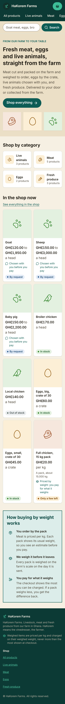

Desktop, 1280 px: 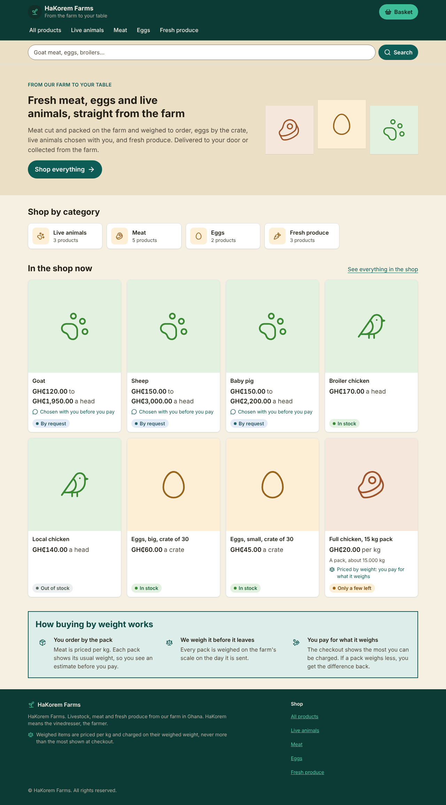

Phone, dark: 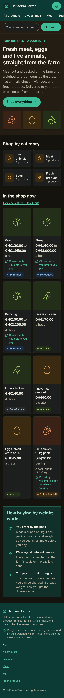

### A category (Meat), with its filters

Phone, 360 px: 

Desktop, 1280 px: 

Phone, dark: 

### Search

Phone, 360 px: 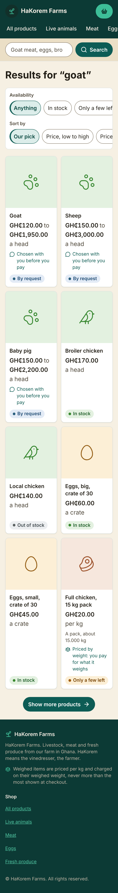

Desktop, 1280 px: 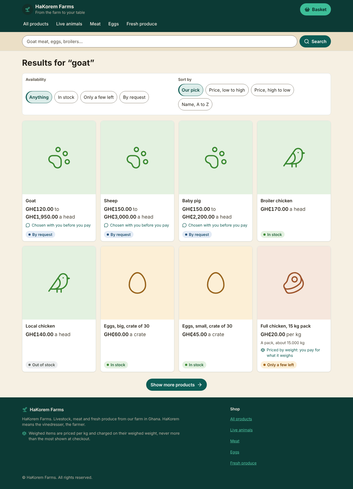

Phone, dark: 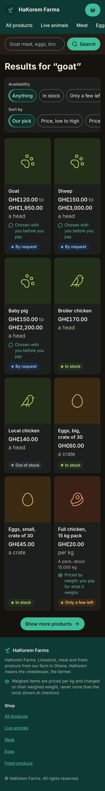

### A weighed product, with the weighed-price notice

Phone, 360 px: 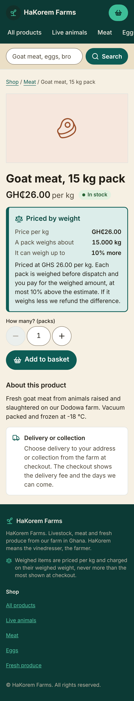

Desktop, 1280 px: 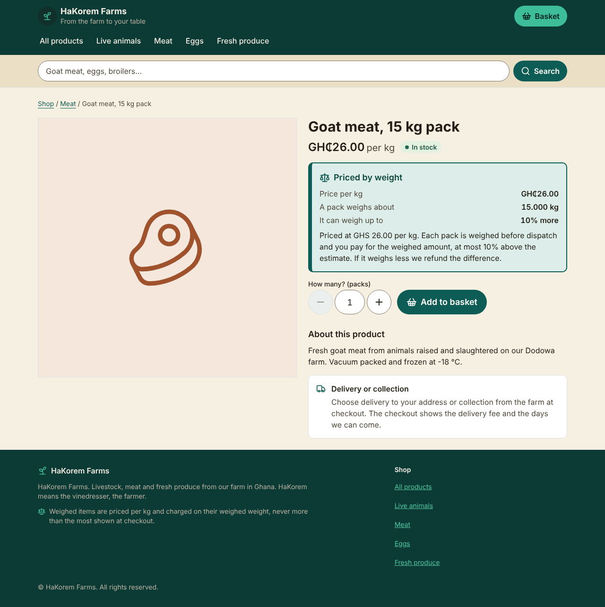

Phone, dark: 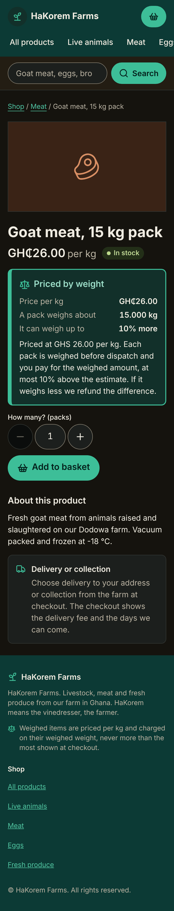

### The basket drawer

Phone, 360 px: 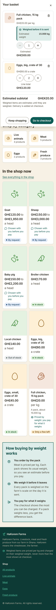

Desktop, 1280 px: 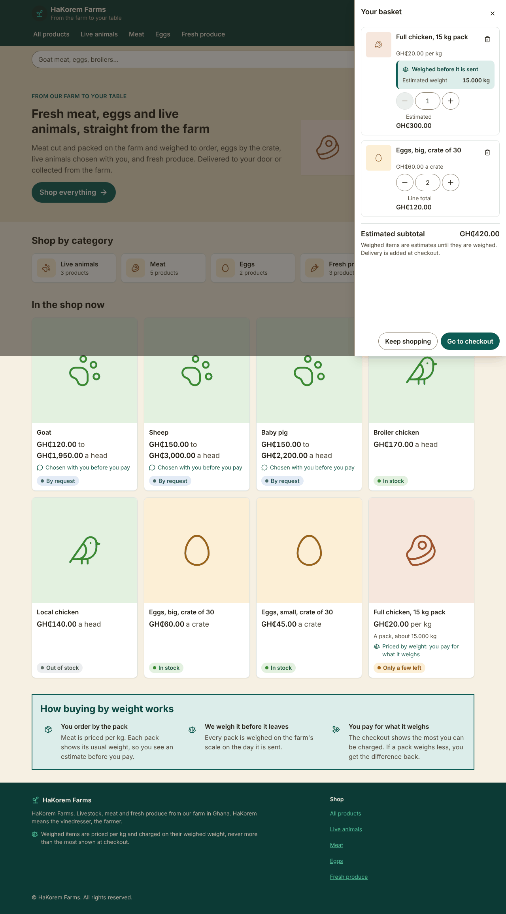

Phone, dark: 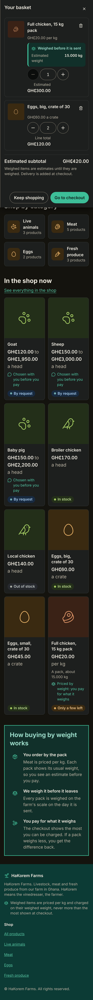

### Checkout: the basket and a coupon

Phone, 360 px: 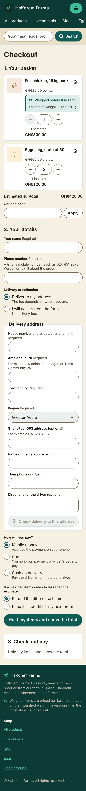

Desktop, 1280 px: 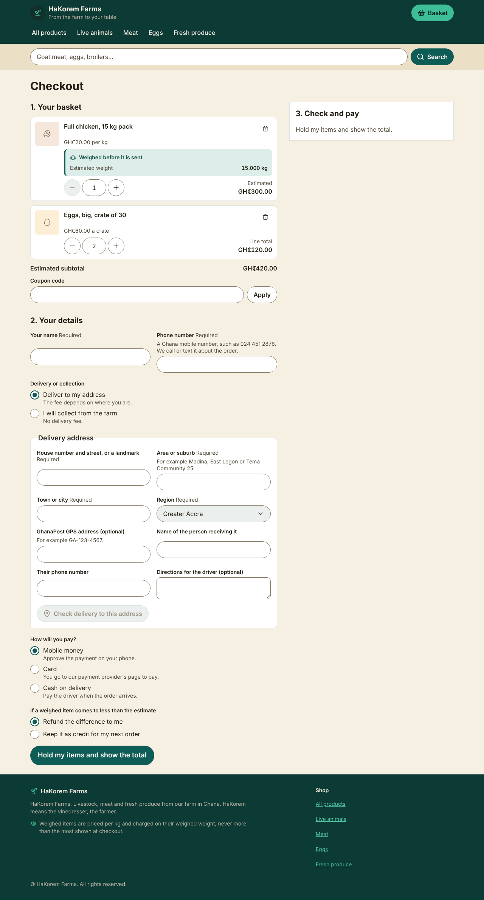

Phone, dark: 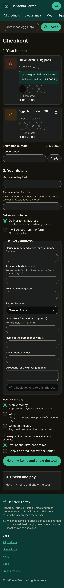

### Checkout: details, delivery checked, a delivery time

Phone, 360 px: 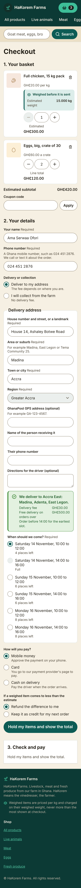

Desktop, 1280 px: 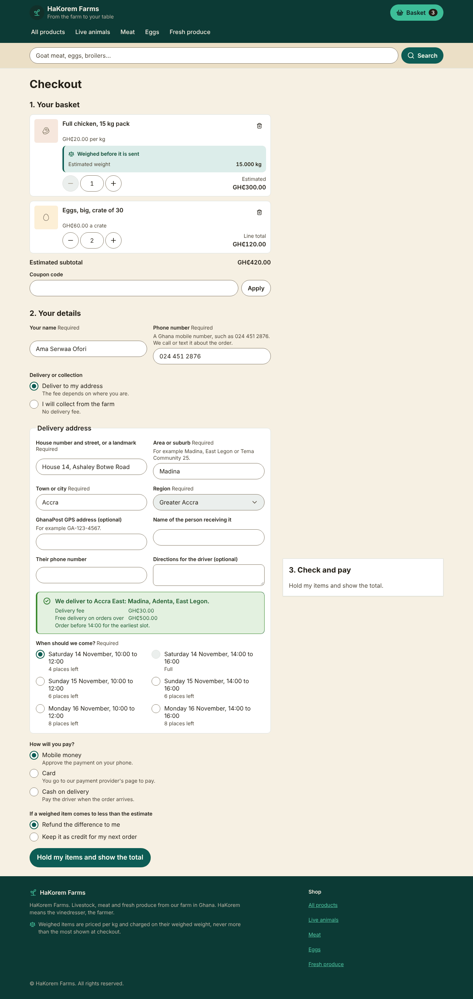

Phone, dark: 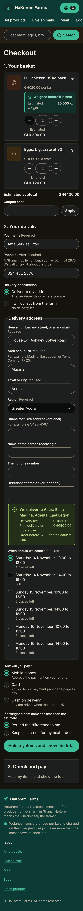

### Checkout: check and pay, the total as an estimate

Phone, 360 px: 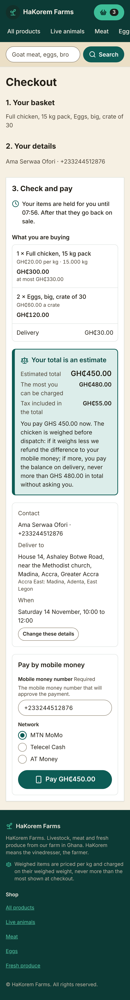

Desktop, 1280 px: 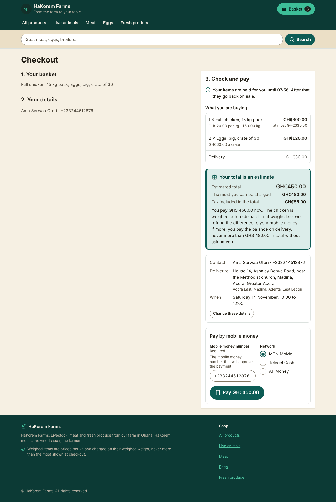

Phone, dark: 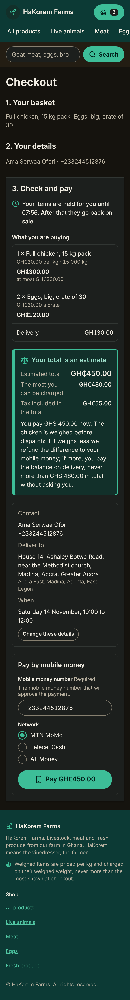

### The order placed, waiting for mobile money

Phone, 360 px: 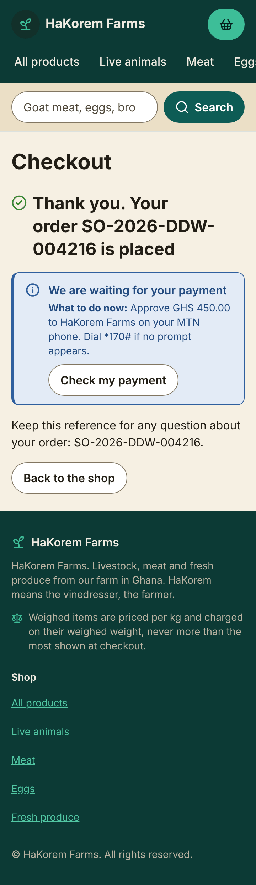

Desktop, 1280 px: 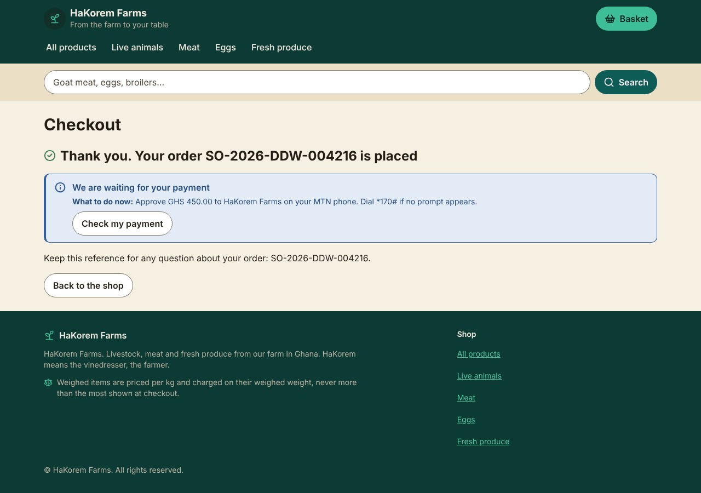

Phone, dark: 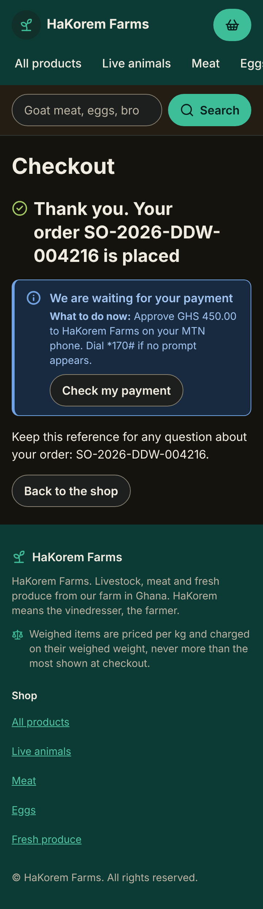

### Checkout with no basket

Phone, 360 px: 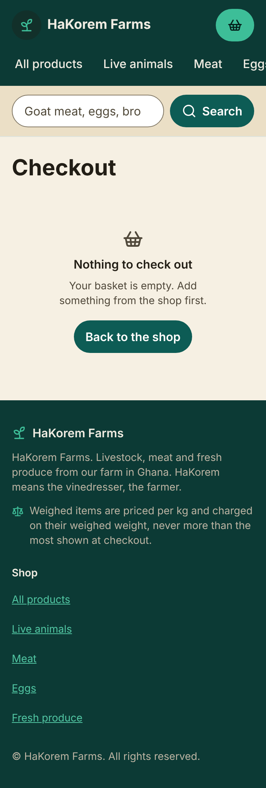

Desktop, 1280 px: 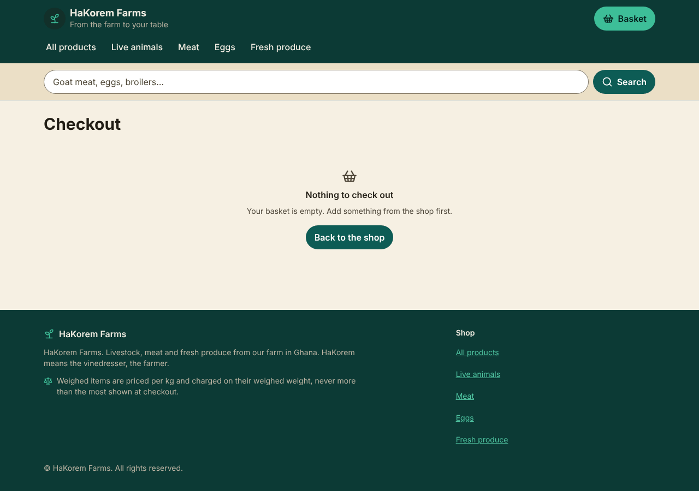

Phone, dark: 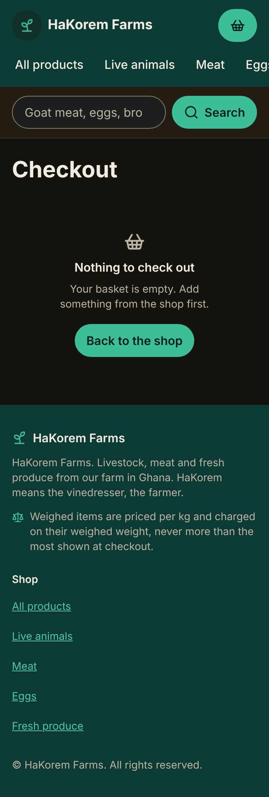

### An unknown category: a real 404

Phone, 360 px: 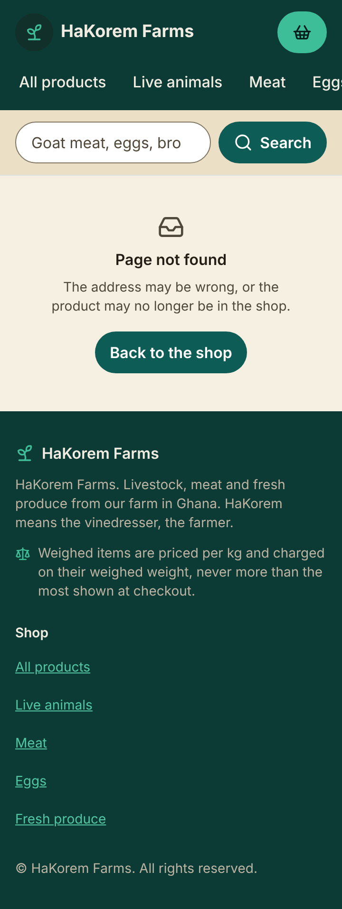

Desktop, 1280 px: 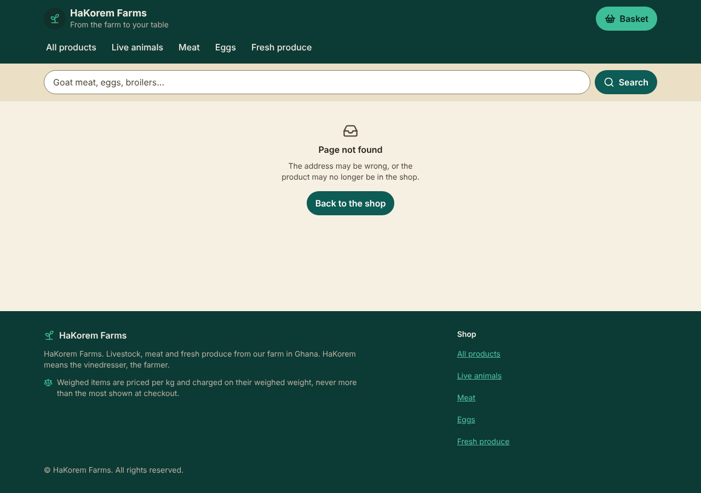

Phone, dark: 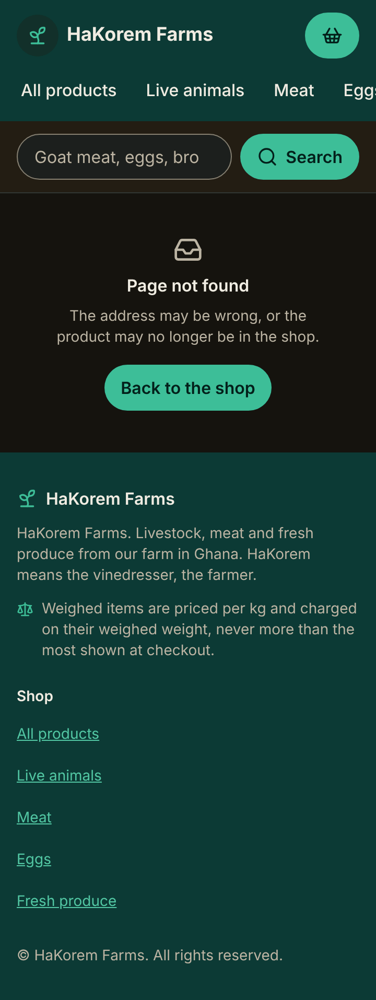

## Moved from the mock to the real API

**None.** CI and e2e build against Prism, and no backend runs here. Per the changelog, these answer from the real API and are ready to move once a live check is possible:

- **the storefront's own:** the catalogue, the categories, guest carts, coupons, delivery slot options and checkout (1.32.0), and the delivery quote. `placeOrder` and `trackOrder` are still planned (B9a and later);
- the processing reversal under approval and the care operations (1.31.0).

## Contract requests added

- **CR-027:** a processing reversal's approval names its order.
- **CR-028:** the shop's contact details, readable by anyone. A live animal's page cannot say whom to call.
- **CR-029:** a cart at checkout says which checkout it is in.

CR-025 is built. CR-023 is partly answered by 1.31.0. CR-026 is still open.

## Assumptions

A-F1-07 and A-F2-06 are resolved, A-F5c-02 is superseded by ADR 0040, A-F6b-02 is partly answered, and A-F0-06 is re-measured and still open. A-F7-01 to 08 are new; the ones that need an answer:

- **A-F7-02:** the browser calls the API directly, with credentials, so F13 must allow the shop's origin on the API (CORS).
- **A-F7-03:** a live animal's page has no phone number to call (CR-028), and no request form until F10.
- **A-F7-04:** a delivery time is required when the zone has open slots.

## Decisions recorded

- **ADR 0040:** the storefront reads as a farm shop. A sand page and band scoped to the shop, the pine header as a dark island, photographs first, no web font.
- **ADR 0041:** the storefront's data layer loads with the basket, not with every page.
- ADR 0015's known limit is closed for categories: an unknown category is a real 404. A product's lookup is in its metadata, which a crawler waits for, so a crawler gets a 404 for a slug that is not listed.

## Gates, each run on its own

| Check                                                               | Exit | Count                                                                                                                               |
| ------------------------------------------------------------------- | ---- | ----------------------------------------------------------------------------------------------------------------------------------- |
| `format:check`, `lint`, `typecheck`                                 | 0    |                                                                                                                                     |
| `tokens:check`, `fonts:check`, `icons:check`, `sync-contract:check` | 0    |                                                                                                                                     |
| `test:unit`                                                         | 0    | ui 882, console 172, storefront 29, data 28, api-client 26, i18n 6                                                                  |
| `test:integration`                                                  | 0    | console 226, storefront 13, against the real Prism (it now runs both apps)                                                          |
| `test:a11y`                                                         | 0    | 313 stories, axe, both themes and densities (16 new)                                                                                |
| `build-storybook`, `build:console`, `build:storefront`              | 0    |                                                                                                                                     |
| `budget:console`                                                    | 0    | back office 278.1 of 300 kB initial script (was 277.0); till 209.0 of 250 kB (was 207.9)                                            |
| `test:e2e`, three full runs in a row                                | 0    | 237 of 237 in each, 4.4 to 4.5 minutes a run, at `7fdfc39`. The storefront has 27 (was 22), with the 3G gate and axe in both themes |
| storefront screenshots (`@screenshots`, storefront project)         | 0    | 33 shots: 11 pages at 360 (2x), 1280, and 360 dark. Shrunk to a 256-colour palette, 10.3 MB to 3.7 MB                               |

### What the gates found, and what was done

- **The first full e2e run: the Farm hand's death photo was refused.** The fake API checked only `uploadFile`'s `x-permission`, while 1.31.0 grants the Farm hand `platform.file.upload.evidence` instead. The fake now models that second permission (`9bb1c7d`).
- **A flaky storefront test, found and fixed, not re-run to green.**
  - **What failed:** a category filter tap did nothing for over 5 s, once in three full runs and four times in six repeats under parallel load, never alone.
  - **What the trace showed:** the RSC payload arrived (200 in 60 ms), but Next's client navigation did not commit while the page was still hydrating.
  - **Why it mattered:** a CPU-starved page is what a cheap phone is.
  - **The fix:** filters and paging are plain links the browser loads itself. The same load then passed 162 of 162 (`7fdfc39`), and the three full runs above are on that build.
- **Axe in the checkout:** the basket button's spoken name did not contain its visible text. Its name is now its words.
- **360 px in the checkout:** the review was 85 px too wide. The weighed-price notice's term column would not wrap, and the pay button's long label could not either. Both were fixed in the component and the words.
- **The ten-run soak F6b did** was cut to three full runs this session; nothing failed in them.

## For the owner

1. **The look.** Judge it on the phone screenshots above. ADR 0040 says what changed and why. The buttons are still the system's pine teal; a storefront-only button colour would need a storefront theme, which is a new mechanism and your decision.
2. **The page weight: one decision brings the listing under the brief's 300 KB.**
   - A listing is 357 KB with its twelve photographs, 246 KB without. Script is 202 KB of that.
   - Its largest paint is still under 2.5 s on 3G, because the paint is text.
   - Nearly all the script above Next and React is the `UIProvider`'s toast and tooltip, about 85 kB, which the storefront never shows.
   - **Loading them on first use** changes UIProvider, a reference component, so it is yours to approve. With it, the listing would be about 270 KB.
   - Smaller levers: eight products a page instead of twelve (about 37 KB of photographs).
3. **The shop's phone and WhatsApp numbers** (CR-028, A-F7-03), so a live animal's page can say whom to call before F10's request form.
4. **CORS for the shop on the API** (A-F7-02), for F13's deployment.

## Opening message for the next session

```text
Read CLAUDE.md, docs/SHARED_BRIEF.md and docs/sessions/F07-storefront-catalogue-and-checkout.md.

First: pnpm sync-contract:github and read .contract-upstream/CONTRACT_CHANGELOG.md after 1.39.0. Answer
what it changes before anything else, including CR-023, CR-026, CR-027, CR-028 and CR-029 if they landed,
and the owner's answers on the F7 look and the UIProvider lever (PERFORMANCE_BUDGET.md, "F7").

Then F8 as BUILD_PROMPT describes: invoices, receipts, credit notes, statements, document viewer and
reprint (BIL is live from 1.39.0 for listBillingDocuments, getBillingDocument, issueCreditNote and
issueDebitNote). Gate: a reprint is visibly a reprint, and the tax breakdown matches the API to the pesewa.
```
