# F8: invoices, receipts, credit notes, statements, the document viewer and reprints

- **Session:** F8, on branch `claude/ecstatic-euler-1wbute`, from `main` at `072345d` (F7 merged).
- **Date:** 2026-11-16
- **Scope:** the F7 report's opening message, and the owner's four decisions:
  1. answer contract 1.40.0 and 1.41.0 first;
  2. F8 as BUILD_PROMPT describes it: invoices, receipts, credit notes, statements, the document viewer and reprint;
  3. **the owner's decisions:** the shop's buttons stay pine green; load toast and tooltip on first use in the shared provider and measure both apps before and after; record for F13 that the shop and the API share one domain with no CORS; show the business's phone and WhatsApp on live animal pages once CR-028 lands.
- **Gate:** a reprint is visibly a reprint, and the tax breakdown matches the API to the pesewa.

## The gate

- **The tax breakdown matches the API to the pesewa.** The document viewer shows each levy's total (`levyTotals`), then the net, the tax and the gross, then every line's levy rows (treatment, rate, base, amount, zero-rated rows included), all as the API issued them.
  - The e2e spec rewrites the document so its figures cannot be got by adding up: GETFund at 1 pesewa and a tax total of 7,651 against levies that sum to 6,695. Each of the six rows on screen is asserted against `formatMoney` of the API's own value, and the page shows `GH₵76.51`.
  - The integration test asserts the contract's example against the real Prism: VAT 57.38, NHIL 9.56, GETFund 9.56, net 1,302.50, tax 76.50, total 1,379.00.
- **A reprint is visibly a reprint.** "Reprint as PDF" confirms first, saying the copy is the archived document with a marker and copy number, not a new document, and that it is logged with the person's name. After it:
  - the page leads with a region named **"Reprint 2: a copy, not a new document"**, in a thick warning frame with a stamp icon, saying "This is copy 2 of Receipt RCP-2026-DDW-T1-018834 … The document itself has not changed and keeps its number";
  - under it, the PDF the API returned (which carries the API's own marker), titled "Reprint 2 of …", and a "Save reprint 2 (PDF)" link whose file is named `RCP-2026-DDW-T1-018834-reprint-2.pdf`;
  - the copy number is the API's `copyNo`, never counted on screen; the title is still the same document under the same number; the reprint history reloads.
  - The spec asserts each of these, that the marker sits above the lines, that exactly one `reprintBillingDocument` was sent with `{ "channel": "PDF" }`, axe clean and no sideways scroll at 360 px.

## First: the contract, 1.39.0 to 1.41.0

Synced with `pnpm sync-contract:github`: backend `c403e20`, contract 1.41.0. Nothing broke the build.

- **1.40.0, reprints and the archive (built).** `reprintBillingDocument`, `listBillingDocumentReprints`, `listArchivedDocuments`, `getArchivedDocument`, `downloadArchivedDocument`. `ReprintResult.pdfBase64` carries a PDF reprint inline. `BillingDocument.archivedDocumentId`, `contentHash` and `reprintCount` are filled.
- **1.40.0, templates.** Six template operations went live. Template editing is not in F8's list; it is for an administration session.
- **1.41.0.** `previewTemplateVersion` answers the bytes inline (LOUD, but no screen used the planned shape). The remittance advice is archived for a paid supplier payment (no screen yet).
- **Refusal words.** `ARCHIVE_HASH_MISMATCH`, `DOCUMENT_NOT_ARCHIVED`, `PREVIEW_DATA_REQUIRED` and `TEMPLATE_BODY_INVALID` have words (ADR 0038's test found them), and so do the reprint rules (`RENDERING`, `NOT_SCANNED`, `NO_THERMAL_RENDITION`) and six credit note rules.
- **CR-026 is answered** by 1.40.0: each 202 names its own subject. Nothing to build until the purchase order and supplier payment screens exist.
- **CR-023, CR-027, CR-028 and CR-029** have not landed. CR-028 is the shop's phone and WhatsApp (below).
- **Still planned:** the statement operations (B08 continued 2d), `sendBillingDocument`, `sendStatement`, `issueProforma`.

## The owner's decisions

1. **Pine buttons.** Recorded in ADR 0040: the shop's buttons stay pine green, with no shop theme.
2. **The page weight (ADR 0042).** Done in the shared provider, and measured in both apps. The provider change alone took only 2 kB off the listing, because F7's diagnosis was wrong: the listing carried almost every client component in `@hakorem/ui`, since Next bundled the package's whole index. One line of Next configuration (`optimizePackageImports`) fixed that. Measured the way F7 measured, `/c/meat` at 360 px:

   | What                                     | Before (F7) | After        | Budget     |
   | ---------------------------------------- | ----------- | ------------ | ---------- |
   | Listing, first-load script (next build)  | 191 kB      | **118 kB**   | 120 kB     |
   | Listing, script on the wire              | 202 KB      | **136 KB**   |            |
   | Listing without photographs, on the wire | 244 KB      | **178 KB**   |            |
   | **Listing with its twelve photographs**  | **357 KB**  | **289 KB**   | **300 KB** |
   | Product page, first-load script          | 220 kB      | 151 kB       |            |
   | Till, initial script                     | 209.3 kB    | **190.8 kB** | 250 kB     |
   | Back office, initial script              | 278.5 kB    | **273.9 kB** | 300 kB     |
   - **Toast** now loads with the first toast and stays mounted. **Tooltip** loads its Radix half with the first tooltip, and puts focus back on the trigger if it had it. Unit tests cover both, including a keyboard user focusing a trigger before the code arrives.
   - **What it costs:** before the first toast there is no notifications region; the first toast waits for one chunk (F13's service worker precaches it with the rest); moving between tooltips no longer skips the delay.
   - The storefront's 27 e2e specs, including the 3G checkout gate, pass on the new build.

3. **One origin, no CORS (F13).** Recorded in `docs/DEPLOYMENT.md`, section 4, which F13 applies:
   - the shop on the apex and the API under a path of it, through the reverse proxy;
   - `HK_API_BASE_URL` stays the one variable, set to the absolute same-origin URL (the server cannot fetch a bare path);
   - the storefront container resolves the shop's host to the proxy, so server reads stay on the box;
   - a Caddy `handle_path /api/*` example, the allowed `Origin`, and how the smoke suite checks each.
   - A-F7-02 is resolved. The decision names the shop only, so the console's route to the API is left for F13 to ask (below).
4. **CR-028, the shop's phone and WhatsApp.** Not in 1.41.0. Recorded in CR-028 and A-F7-03: when the public read lands, live animal pages show the numbers with a WhatsApp link. It is in the next session's opening message.

## What was built

| Route                                | Screen                                                                                                                                        | Reads / writes                                                                                                                   |
| ------------------------------------ | --------------------------------------------------------------------------------------------------------------------------------------------- | -------------------------------------------------------------------------------------------------------------------------------- |
| `/billing-documents`                 | Every invoice, receipt, proforma, credit note and debit note: number, kind, customer, issue date, total, outstanding and payment state        | `listBillingDocuments` (kind, payment state, issue dates, document number or till reference)                                     |
| `/billing-documents/:id`             | The document viewer: details, payment, lines, the tax breakdown, the archived copy and the reprint history; reprint, credit and debit actions | `getBillingDocument`, `getArchivedDocument`, `downloadArchivedDocument`, `listBillingDocumentReprints`, `reprintBillingDocument` |
| `/billing-documents/:id/credit-note` | Credit each line by a quantity or an amount, with a refund or return reason; confirmed, then sent for approval (202)                          | `listReasonCodes` (REFUND, RETURN), `issueCreditNote`                                                                            |
| `/billing-documents/:id/debit-note`  | Charges, each with an amount and a tax category; confirmed, then issued at once (201)                                                         | `listReasonCodes` (BILLING_ADJUSTMENT), `listTaxCategories`, `issueDebitNote`                                                    |
| `/statements`, `/statements/:id`     | Customer statements, and one with its summary and movements with the running balance                                                          | `listStatements`, `getStatement` (planned: the mock)                                                                             |
| `/statements/new`                    | Draw one up for a customer and a period, as a draft preview or issued                                                                         | `listCustomers`, `createStatement` (planned: the mock)                                                                           |

- **Nothing is computed.** Every total, levy, outstanding amount, balance and copy number is the API's. A credit note's confirmation lists what is being credited, as entered, and says the API works out the tax on it; a debit note's lists each charge and says the API adds the tax. No total is summed on screen.
- **Four states** on every screen: a skeleton; an empty list in words (with a filtered variant); an error with its reference and a retry; permission denied in words. A document that does not exist is a "does not exist" page with a way back.
- **Permissions by state:** reprint needs `bil.document.reprint` and an archived copy; credit and debit only on an issued invoice or receipt, each with its own permission; the archived original needs `doc.document.read`, and a person without it is told so. A credit note waiting for approval shows as such, with no number and no actions.
- **The archived copy:** while a document is drawn up after issue, the page says so and reprints wait. Once archived, its SHA-256 fingerprint; for the archive's readers, the template version, revision and a signed link to the original that says when it expires. The page says viewing the original is not a copy for a customer: that is a reprint.
- **A failed write stays on screen**, in the dialog or the form, in the console's words with its reference.
- **Billing** is a sidebar group (invoices and receipts, customer statements). An approval request naming a billing document now links to it.
- **No new component in `packages/ui`.**

## The screenshots

The production build on the mock, signed in as the owner, at 1280 px and 360 px, light theme (`pnpm screenshots`, `docs/screenshots/F08/`).

### Invoices and receipts

Phone, 360 px: 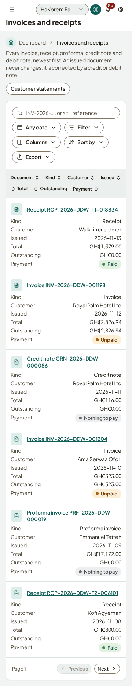

Desktop, 1280 px: 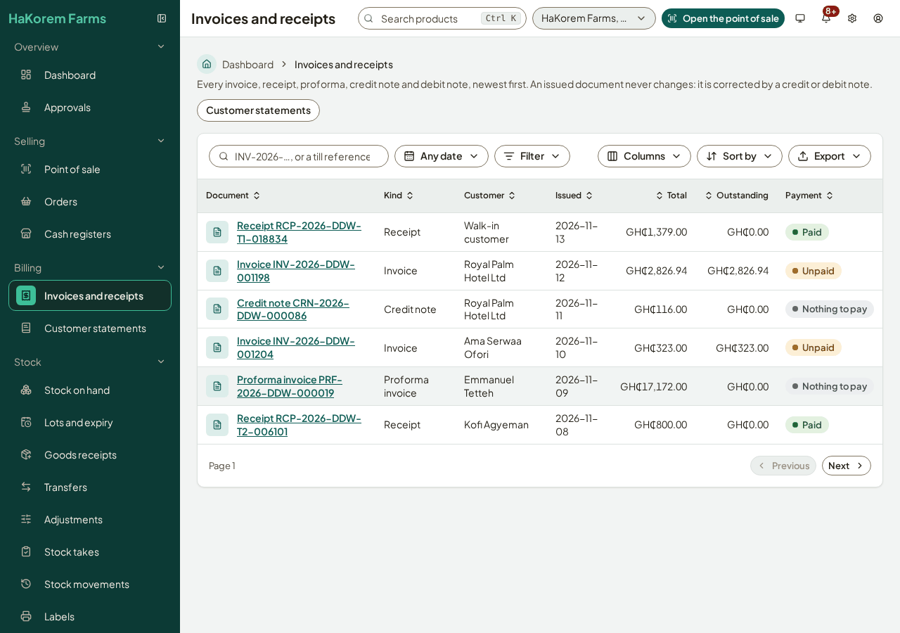

### A receipt in the document viewer: details, payment, lines, the tax breakdown, the archive and the reprint history

Phone, 360 px: 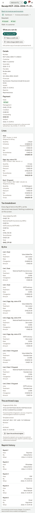

Desktop, 1280 px: 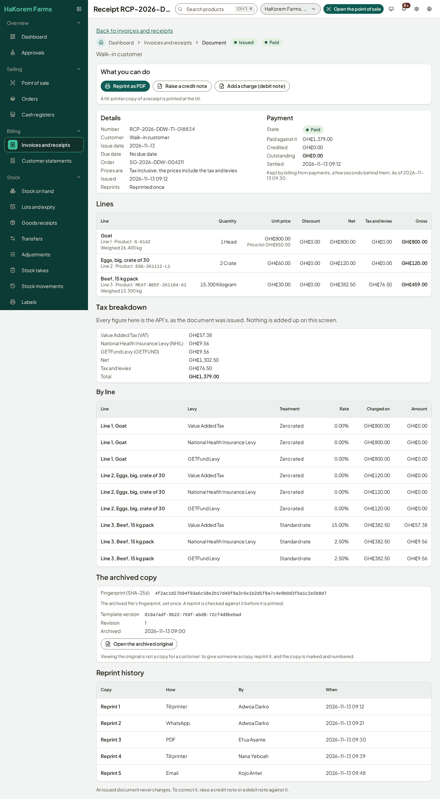

### The same receipt after a PDF reprint: the marker leads the page

Phone, 360 px: 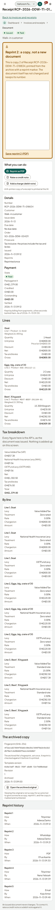

Desktop, 1280 px: 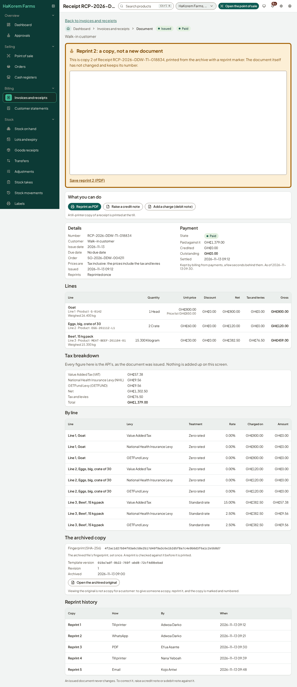

### The document viewer, dark theme

Phone, 360 px: 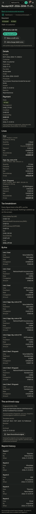

Desktop, 1280 px: 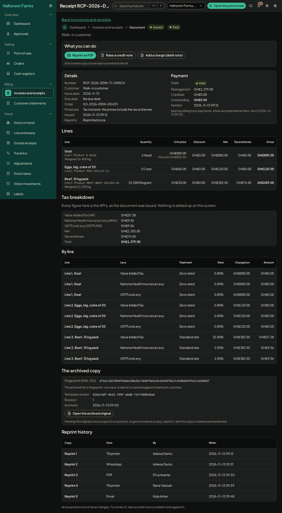

### A credit note against the receipt

Phone, 360 px: 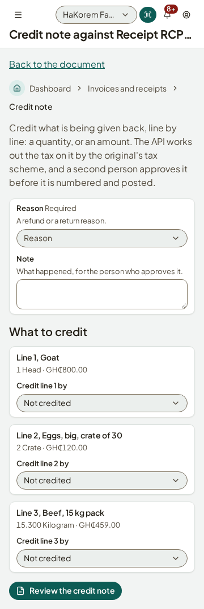

Desktop, 1280 px: 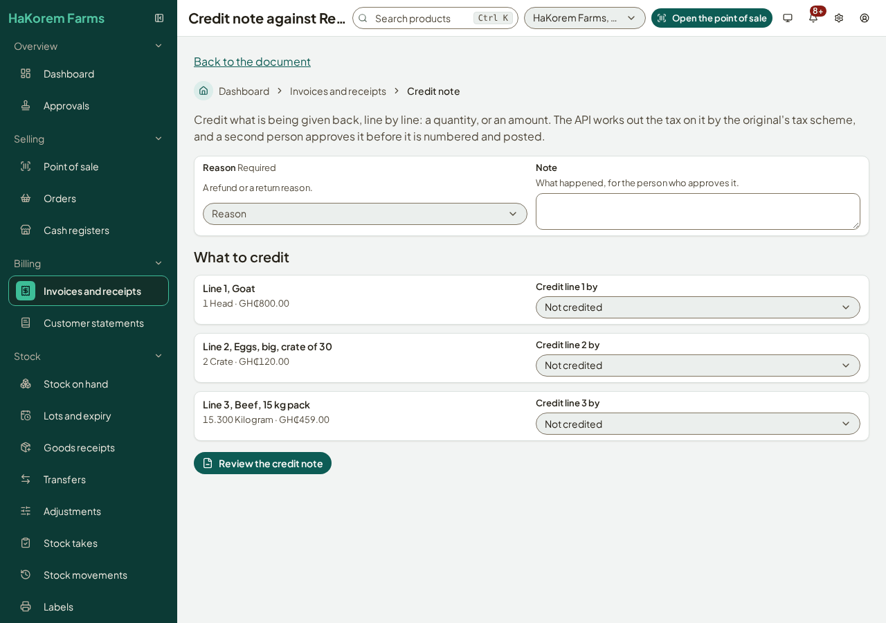

### A debit note against the receipt

Phone, 360 px: 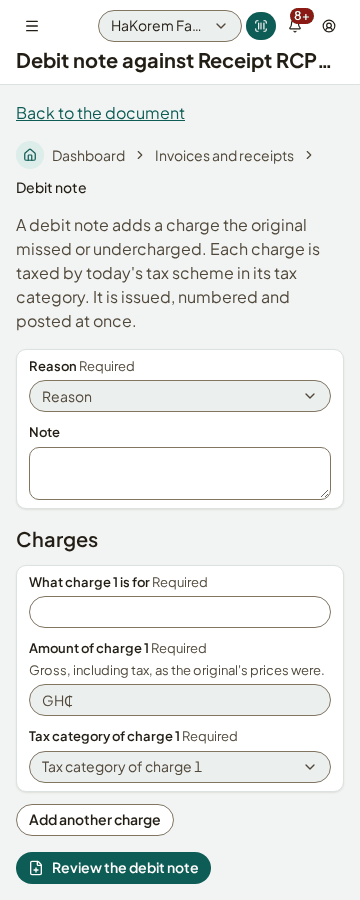

Desktop, 1280 px: 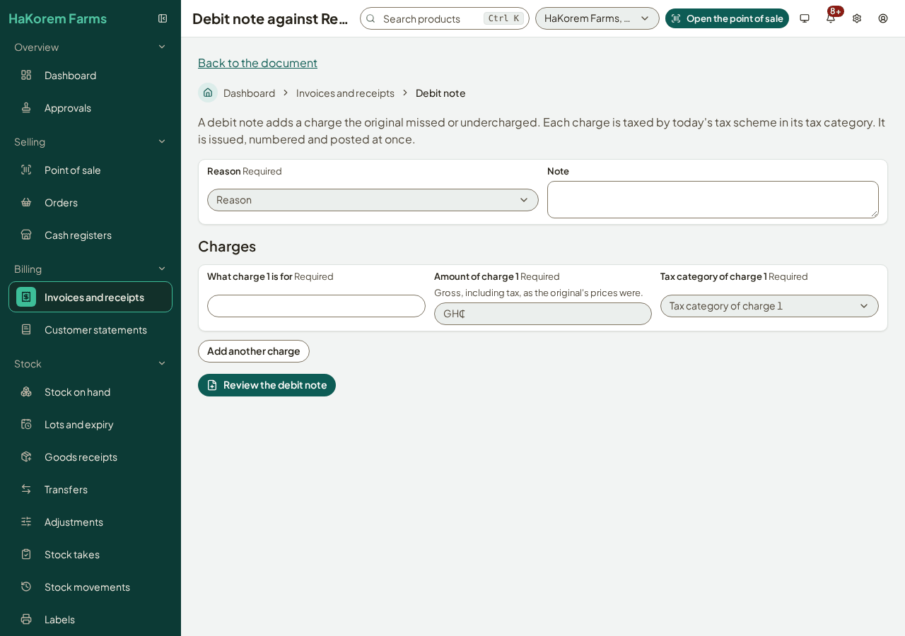

### Customer statements

Phone, 360 px: 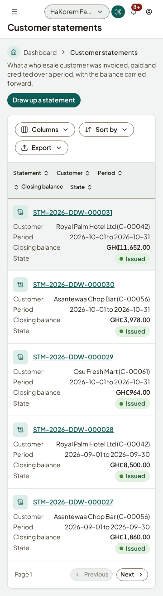

Desktop, 1280 px: 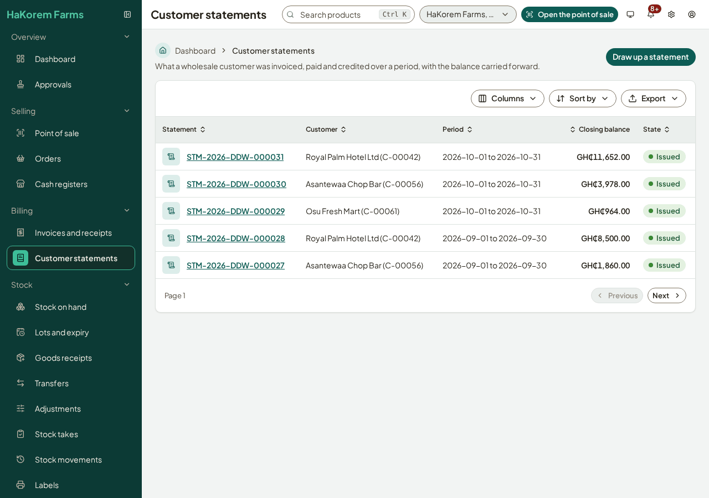

### One statement

Phone, 360 px: 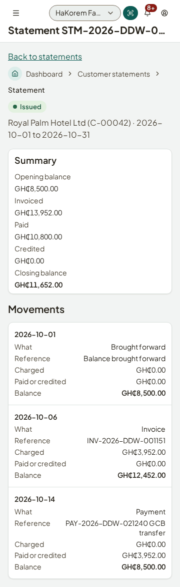

Desktop, 1280 px: 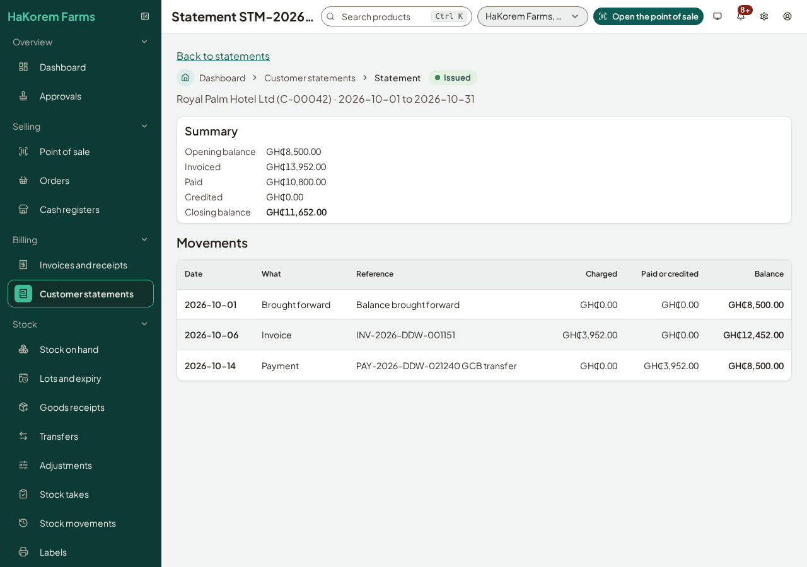

### Drawing up a statement

Phone, 360 px: 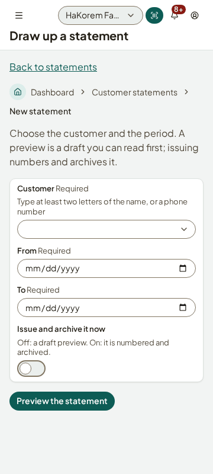

Desktop, 1280 px: 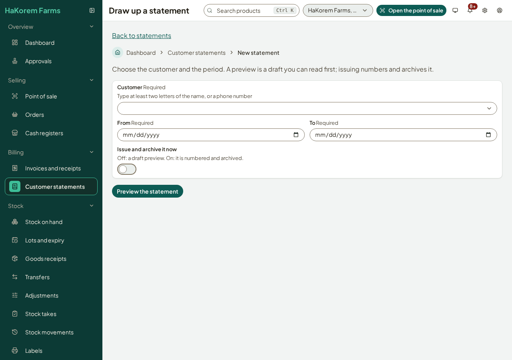

Headless Chromium has no PDF viewer, so the reprint's frame is blank in the shots; in a browser it shows the API's PDF with its own marker. The receipt's reprint history is the contract's example, which lists five copies while the document says it was reprinted once (CR-030). The shots are shrunk to a 256-colour palette (3.1 MB to 1.2 MB).

## Moved from the mock to the real API

**None.** CI and e2e build against Prism, and no backend runs here. Per the changelog, these answer from the real API and are ready to move once a live check is possible: the billing documents and the document viewer, credit and debit notes (1.39.0), reprints and the archive (1.40.0). The statements are still planned.

## Contract requests added

- **CR-030:** the billing examples contradict their operations: no PDF reprint example, the credit note's 202 names a stock adjustment, the debit note's 201 answers a receipt, the archive's hash differs from the document's, the reprint count disagrees with the history, and the reason example has no billing adjustment or return reasons.

CR-026 is answered by 1.40.0. CR-023, CR-027, CR-028 and CR-029 are still open.

## Assumptions

A-F7-02 is resolved by the owner (one origin). A-F7-03 waits on CR-028. New:

- **A-F8-01:** the back office reprints as PDF only; a till-printer copy is the till's (F9).
- **A-F8-02:** statements are built against the planned operations.
- **A-F8-03:** the fake roles' billing permissions follow 1.39.0 and 1.40.0; who raises a credit note is not said, so only the Owner does (CR-023).
- **A-F8-04:** the archived original opens through a link the person follows.

## Decisions recorded

- **ADR 0042:** toast and tooltip load on first use; the storefront imports each `@hakorem/ui` component on its own. ADR 0006 is amended to say so.
- **ADR 0040:** the shop's buttons stay pine green (owner).
- **`docs/DEPLOYMENT.md` section 4:** the shop and the API on one origin (owner).

## Gates, each run on its own

| Check                                                               | Exit | Count                                                                                                                                                         |
| ------------------------------------------------------------------- | ---- | ------------------------------------------------------------------------------------------------------------------------------------------------------------- |
| `format:check`, `lint`, `typecheck`                                 | 0    |                                                                                                                                                               |
| `tokens:check`, `fonts:check`, `icons:check`, `sync-contract:check` | 0    |                                                                                                                                                               |
| `test:unit`                                                         | 0    | ui 883 (was 882), console 172, storefront 29, data 28, api-client 26, i18n 6                                                                                  |
| `test:integration`                                                  | 0    | console 234 (8 new, billing), storefront 13, against the real Prism                                                                                           |
| `test:a11y`                                                         | 0    | 313 stories, axe, both themes and densities                                                                                                                   |
| `build:console`, `build:storefront`                                 | 0    |                                                                                                                                                               |
| `budget:console`                                                    | 0    | back office 273.9 of 300 kB initial script (was 278.5); till 190.8 of 250 kB (was 209.3)                                                                      |
| storefront listing, measured on the wire                            |      | 178 KB without photographs (was 244), about 289 KB with them, under 300 KB                                                                                    |
| `test:e2e`, full runs                                               | 0    | two full runs in a row, 249 of 249 in each (237 before F8), 4.2 to 4.6 minutes a run. Billing has 12 specs, with the gate, axe and 360 px on all seven routes |
| console screenshots (`@screenshots F08`)                            | 0    | 18 shots: 9 screens at 1280 and 360 px                                                                                                                        |

### What the gates found, and what was done

- **The provider change alone did not move the listing** (191 to 189 kB). Reading the chunks found the package index in the listing's script; `optimizePackageImports` fixed it (ADR 0042). F7's 85 kB estimate is corrected in `PERFORMANCE_BUDGET.md`.
- **ADR 0038's test found four new refusal codes** without words after the sync; they have words now.
- **The token rule refused `border-warning-strong`** on the reprint marker (a surface, not a line); it uses `border-warning`.
- **The React hooks rule refused a state set in an effect** for the reprint's PDF link; the link is now derived, and a replaced copy's link is released.
- **Prism answers `issueCreditNote` with its 201**, not the 202 a credit note raised on its own always gets; the integration test asks for the 202, as the e2e spec does.
- **The contract's examples disagree with their operations** in six places (CR-030); the specs give the answers the descriptions promise.
- **The per-line levy table is long at 360 px** (nine stacked rows for three lines). It is kept open: the brief asks for the full breakdown on the document. A later pass could fold it.

## For the owner

1. **The console and the API.** You decided the shop and the API share one domain. The console is on its own subdomain (shared brief). Should its host also proxy an `/api` path to the API, so the console has no CORS either? F13 needs the answer (DEPLOYMENT.md section 4).
2. **The till-printer reprint.** The back office reprints receipts as PDF. A paper-roll copy is printed at the till in F9 (A-F8-01). Say if the back office should drive a receipt printer too.
3. **Who raises credit notes.** The contract names who approves them (Owner, Manager) but not who raises them. The fake gives it to the Owner only until the role matrix is published (CR-023, A-F8-03).

## Opening message for the next session

```text
Read CLAUDE.md, docs/SHARED_BRIEF.md and docs/sessions/F08-billing-documents-and-reprints.md.

First: pnpm sync-contract:github and read .contract-upstream/CONTRACT_CHANGELOG.md after 1.41.0. Answer
what it changes before anything else, including CR-023, CR-027, CR-028, CR-029 and CR-030 if they landed.
If CR-028 landed (the business's public phone and WhatsApp numbers), show them on live animal pages with a
WhatsApp link (owner, 2026-11-16). If the statements moved into code, check the statement screens against them.
Read the owner's answers to the F8 report's "For the owner".

Then F9 as BUILD_PROMPT describes: the POS sale, barcode and weight capture, split tender, hold and recall,
returns, shift open and close, offline first. Gate: a full sale completes with the network off and syncs
exactly once on reconnect.
```
