# F10: the till PIN and the digital receipt, against the mock (not the quote builder)

- **Session:** F10, on branch `claude/f10-session-contract-sync-76ir1u`, from `main` at `382a820` (F9 and its contract requests merged).
- **Date:** 2026-11-16
- **What "F10" means here.** The owner named this session F10 and asked it to follow the F9 report's opening message. That message keeps building the till against the mock and says plainly that the **BUILD_PROMPT's F10 phase (the quote builder, the request-for-quote form, wholesale accounts) does not start until B9b has proved the till's sync contract** (owner, 2026-11-16). So this report is F10 by number and F9's continuation by scope: nothing of the quote builder was built. The next session's opening message below keeps the same rule.
- **Scope:** the F9 report's opening message, items 1 to 4: sync the contract and answer it; ADR 0045's digital receipt and optional 58 mm Bluetooth printer, removing the 80 mm print-to-page receipt; the till PIN (offline unlock, a supervisor's approval offline, a cash drop's witness) with the attempt limit and lockout; and keep "Which parts of the gate wait for B9b" current.
- **B9b is not built.** Everything here runs against the mock, and the two contract requests it needs (CR-032, CR-033) are built against exactly their requested shapes behind a build switch (ADR 0046).

## First: contract 1.44.0

Synced with `pnpm sync-contract:github`: backend `c19ec6c`, contract 1.42.0 to 1.44.0.

- **1.43.0 and 1.44.0, payments.** Eighteen planned PAY operations move into code: payments recorded by hand, cheques and reversals, store credit and open items, settlement reports, bank statements and the reconciliation break queue. One LOUD change, to an operation no screen used: `resolveReconciliationBreak` answers 202 `ApprovalPending`. The one thing that reached the console is the new approval kind `RECONCILIATION_BREAK`: the inbox's kind order is a `Record` over the enum, so the typecheck failed until it was placed and named ("Reconciliation break resolution").
- **CR-030 landed (1.43.0, examples).** Two specs had leaned on the old examples and failed once, each fixed to the contract: the billing document now says "Reprinted 5 times" (the example's `reprintCount` 5, matching its history), and the stock write-off spec names its own "Past expiry date" reason, which the rewritten `listReasonCodes` example no longer lists.
- **Not landed:** B9b (no till operation changed), CR-023, CR-027, CR-028, CR-029, CR-031, CR-032 and CR-033. CR-028 (the shop's phone and WhatsApp) has not landed, so live animal pages are unchanged.

## How a request is built before the contract carries it (ADR 0046)

The opening message asks for "a local mock override shaped exactly as" CR-032 and CR-033 ask. Nothing in the console had ever called an operation the contract does not list, so this needed a decision:

- `HK_REQUESTED_CONTRACT=CR-032,CR-033` builds the console against those requests. **Only the e2e and CI builds set it.** A deploy leaves it unset (DEPLOYMENT.md section 5), and then the console calls nothing the contract lacks and each feature says in words that it waits for the server.
- The requested shapes live only in `apps/console/src/requested/` (`tillPin.ts`, `digitalReceipt.ts`), each citing its request. `ApiClient.callRequested` sends a requested operation through the same transport as `call` (refresh, CSRF, the device credential, the timeout, the error envelope) and refuses one the contract now lists.
- The e2e fake answers requested operations after its usual session, permission and device-credential checks (`e2e/support/requested.ts`).
- CR-032 and CR-033 now state their exact shapes in `docs/CONTRACT_REQUESTS.md`. Reading 1.44.0 first narrowed CR-032: the contract already carries the approver of an offline mobile money tender (`unverifiedMobileMoney.approvedById`) and a cash drop's witness (`witnessId`), so it asks only for the verifiers and the verifier version.

## What was built

| Where                          | What                                                                                                                                                                                                                                                                                                                                                                                                                            | Against                         |
| ------------------------------ | ------------------------------------------------------------------------------------------------------------------------------------------------------------------------------------------------------------------------------------------------------------------------------------------------------------------------------------------------------------------------------------------------------------------------------- | ------------------------------- |
| The shell                      | **Lock the till**, and the till locks itself after the policy's idle time. Locked, the lock screen replaces the bar and the sale; only the shift's cashier's PIN opens it, checked on the device with no network. The sale under way stays mounted, hidden, and is as it was                                                                                                                                                    | CR-032 (requested)              |
| PIN checks                     | PBKDF2-SHA256 through Web Crypto, compared in constant time; four to six digits checked before hashing (a typo costs no attempt); the policy's attempts then a lockout per person, kept on the device so a reload does not reset it (ADR 0047)                                                                                                                                                                                  | CR-032                          |
| `/pos` payment                 | Offline, mobile money is offered only where the pack lists the method offline (the branch's setting, OFFLINE_SYNC 5.2), as an **unverified tender on a supervisor's PIN** (5.3): amount, payer, network, the customer's transaction id; sent as the contract's `unverifiedMobileMoney` with `approvedById`. The receipt says "Mobile money, not yet verified" with the reference                                                | Contract (tender), CR-032 (PIN) |
| `/pos` payment                 | **The customer's phone for the receipt**, optional, E.164, shown on the confirmation and sent as the contract's `customerPhone`                                                                                                                                                                                                                                                                                                 | Contract                        |
| `/pos/shift`                   | A **cash drop takes its witness's PIN**; the drop carries `witnessId`                                                                                                                                                                                                                                                                                                                                                           | Contract (field), CR-032 (PIN)  |
| `/pos` done, `/pos/queue` copy | **The customer's receipt.** The digital receipt: the SMS to the phone given, in words before and after the server's answer (`receiptMessage`), and the receipt link made on the till from the pack's template, offline. **The optional printer**: "Connect a receipt printer" on a tap, "Print on MTP-II", failures in words that stay; where the browser has no Web Bluetooth (Safari on iOS), it says so and offers no button | CR-033 (requested), ADR 0045    |
| Printed receipt                | 58 mm ESC/POS, 32 columns, plain ASCII (money as `GHS 1,234.50`), **the sale reference labelled as a sale reference**, the official number once known, a copy marked as a copy, and a QR of the link (or the sale id) **drawn by the printer itself** (`GS ( k`)                                                                                                                                                                | ADR 0045                        |
| `/pos/queue`                   | Each record a PIN approved names the approver and the verifier version ("Mobile money approved: Kwabena Owusu's PIN (version 7)"), kept on the device until CR-032 adds the version to the sync                                                                                                                                                                                                                                 | CR-032                          |

- **The F9 80 mm print-to-page receipt is gone** (`window.print`, the `print:` styles). The on-screen receipt stays, as the receipt the till shows.
- **Forgotten at shift end and sign-out:** the verifiers, the attempts and the lock (OFFLINE_SYNC section 3). The queue stays.
- **The till never waits on the network** for any of it: the sale is complete when the cashier confirms, the link is made offline, the printer is optional.
- **Four states:** the lock screen and the receipt panel load with words; empty in words (no phone given, no link from this server, no printer); errors in words that stay (wrong PIN with the tries left, a lockout with its time, a printer that did not connect or print, an SMS that failed); permission in words (no verifier for that person, nobody here who can approve).
- **Without the switch** (a real API today): no lock button, mobile money offline says "needs a supervisor's PIN on this till, which it does not hold. Take cash", a cash drop is recorded without a witness, the digital receipt says the server does not send SMS receipts or links yet. The printer works either way.

### Not built, and why

- **No QR code on the till's screen** (A-F10-03, Q-F10-01). Adding a QR encoder dependency was refused by this session's permission check, and a hand-written encoder could not be checked against a decoder here, so an unscannable code could reach the counter. The link shows as text; the printer prints it as a QR it draws itself.
- **The customer's receipt page on the storefront** (CR-033 item 3, A-F10-04): it reads `getPublicReceipt`, which the storefront's e2e (Prism behind Next's server) cannot answer in a requested shape. The link the till shows points where that page will be.

## The gate, and which parts wait for B9b

The F9 gate (a full sale with the network off, synced exactly once on reconnect) still passes unchanged, with the 80 mm receipt replaced. What F10 proved, **on the mock, in Chromium at 360 px, against the production build** (`e2e/specs/console/pos-pin-receipt.spec.ts`, eight specs):

- The till locks and opens on the cashier's PIN **with the network off**, with no request sent; the sale under way is kept; a wrong PIN (the manager's) says how many tries are left.
- Three wrong PINs lock the cashier out; the right one waits for the time; **a reload stays locked**.
- The till **locks itself after two minutes untouched** (the policy's `idleLockSeconds`, on Playwright's clock).
- **OFFLINE_SYNC 9.9 at the counter:** with the network off, GH₵200.00 mobile money approved by the manager's PIN after one wrong try, GH₵450.00 cash from GH₵500.00, change GH₵50.00; the receipt says not yet verified with the reference; on reconnect the batch carries `unverifiedMobileMoney` with the manager as `approvedById`; the queue names the PIN and its version.
- A cash drop with its witness's PIN reaches the server with `witnessId`.
- The digital receipt: the phone given reaches the server as `customerPhone`; "Sent by SMS" once the sync answers; the link is the pack's template with the sale's UUIDv7.
- **No Web Bluetooth** (Safari on iOS, simulated): the till says so in words, offers no print button, and the sale is complete.
- **A printer where there is one** (simulated Web Bluetooth): connected on a tap, the bytes it receives start with the reset, carry "Sale reference P-T1-312-0001", the total and change in GHS, and the QR of the link.

**Below the browser:** the PIN check against Node's own PBKDF2, the shape rule, the lockout and its exact end, the approvers; the till's lock, unlock, lockout across time, the approval records, and 9.9's worked example to the pesewa (31,000 as 20,000 unverified mobile money and 11,000 cash from 15,000, change 4,000); the 58 mm receipt line by line, ASCII only, the QR command bytes; the Bluetooth chunking, the reconnect, the failures; the switch. **Against the real Prism:** a sale with `customerPhone` and an unverified tender, and a cash drop with `witnessId`, accepted.

### Which parts of the gate wait for B9b (kept current)

Items 1 to 11 of the F9 report all still wait: B9b has not landed and no till operation moved. Status of each after F10:

1. **Exactly once on the server:** waits. Unchanged.
2. **The hash agrees:** waits. F10's sales carry `customerPhone` and `unverifiedMobileMoney` inside the hashed sale; the server's canonical form must include them exactly as sent.
3. **The id window:** waits.
4. **The shift** (sequence, the 409, the close refused while a sale is missing): waits.
5. **Counter gaps:** waits.
6. **Stock and price exceptions:** waits.
7. **The device credential** (revocation, a wrong credential): waits. Now also: the till's PIN verifiers are fetched with the device credential (CR-032), so a revoked till gets no new verifiers.
8. **The server's total read back:** waits (CR-031).
9. **Mobile money at the counter:** online, still examples only. **Offline (new):** the unverified tender is proved on the device and its shape accepted by Prism; that the server records it `UNVERIFIED`, raises the `UNVERIFIED_PAYMENT` break and checks the approver's permission at sync waits for B9b.
10. **The close, held sales, returns:** waits.
11. **A session that expires during a sync:** waits.

New with F10, waiting for CR-032 and CR-033 as well as B9b:

12. **The PIN verifiers** come from the server in CR-032's shape, with the server's PBKDF2 matching the till's for the same PIN, salt and cost; a revoked operator gets none.
13. **An approval checked at sync:** the approver's permission, and (once CR-032 adds it) the verifier version; a revoked or superseded one flagged, never accepted silently.
14. **The receipt SMS** sent once, on the first sync, and `receiptMessage` on the result; a resend sends nothing.
15. **The receipt link** from `OfflinePack.receiptLinkTemplate`, and the public page answering "being recorded" for a sale it has not seen.

## The screenshots

The production build on the mock, built against CR-032 and CR-033, at 1280 px and 360 px (`pnpm screenshots`, `docs/screenshots/F10/`). Each sets the device up as till T1 and opens Adwoa Darko's shift first. Shrunk to a 256-colour palette (1.3 MB to 0.5 MB).

### The till locked, after a wrong PIN

Phone, 360 px: 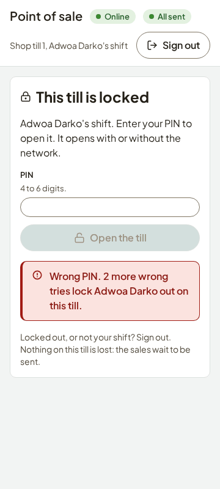

Desktop, 1280 px: 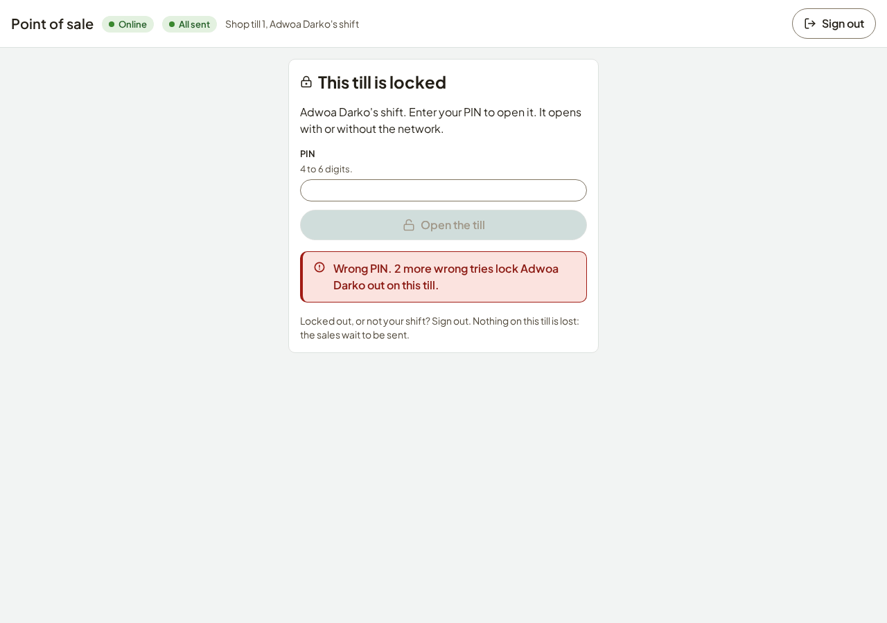

### Mobile money with no network, approved by the supervisor's PIN

Phone, 360 px: 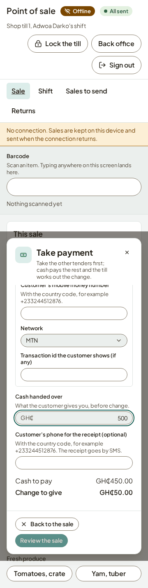

Desktop, 1280 px: 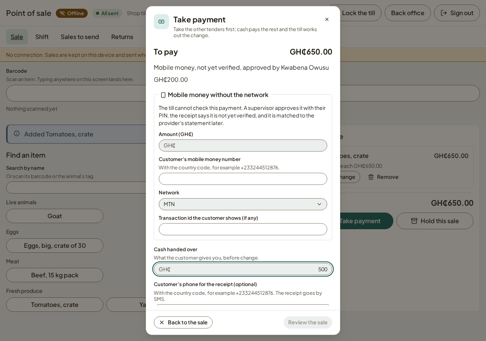

### The sale complete: the receipt says the mobile money is not yet verified

Phone, 360 px: 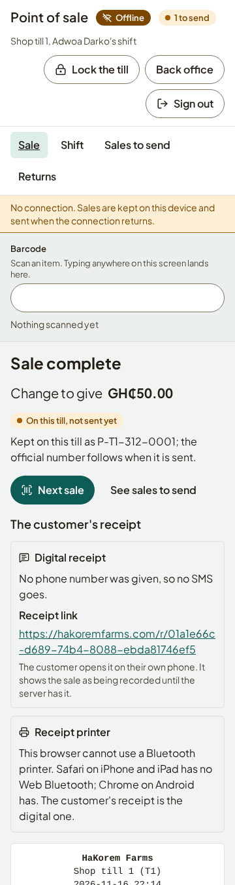

Desktop, 1280 px: 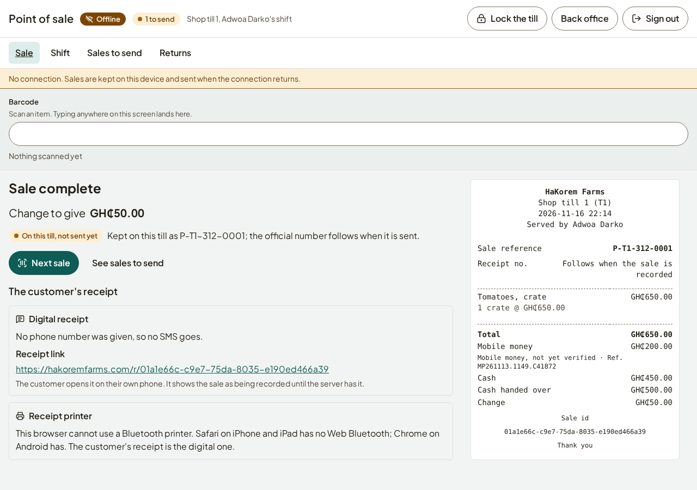

### The queue names the PIN that approved it

Phone, 360 px: 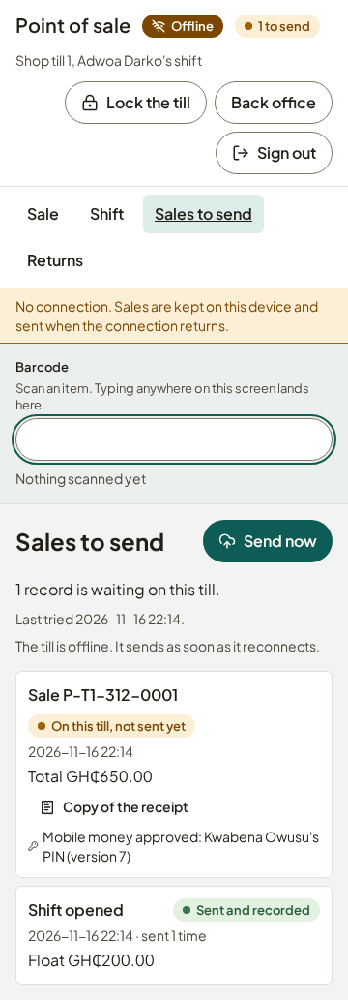

Desktop, 1280 px: 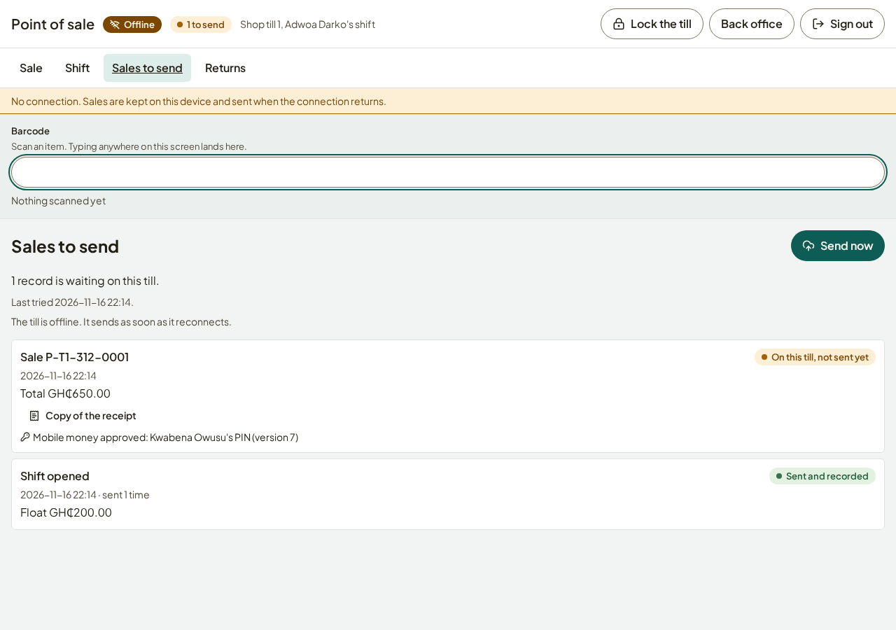

### A cash drop witnessed by PIN

Phone, 360 px: 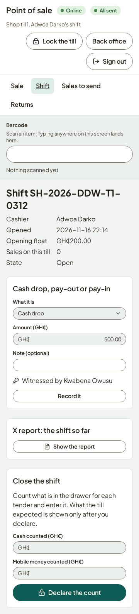

Desktop, 1280 px: 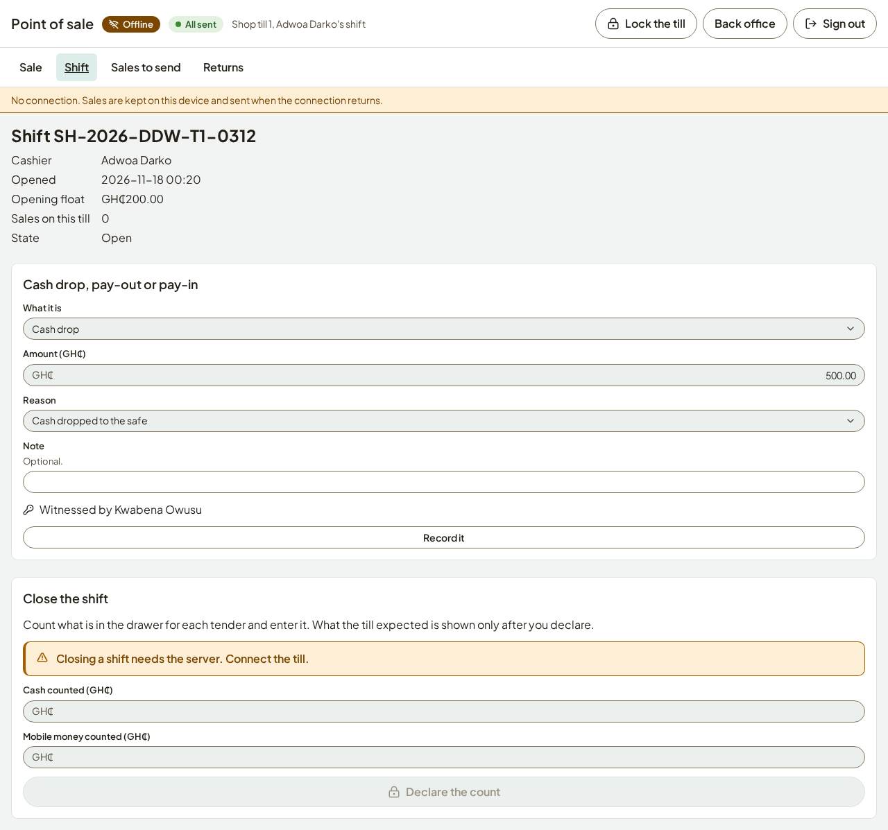

### The digital receipt, with no Web Bluetooth in this browser

Phone, 360 px: 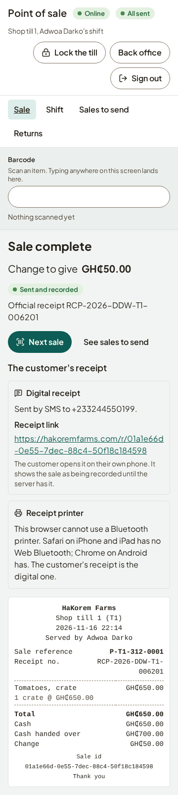

Desktop, 1280 px: 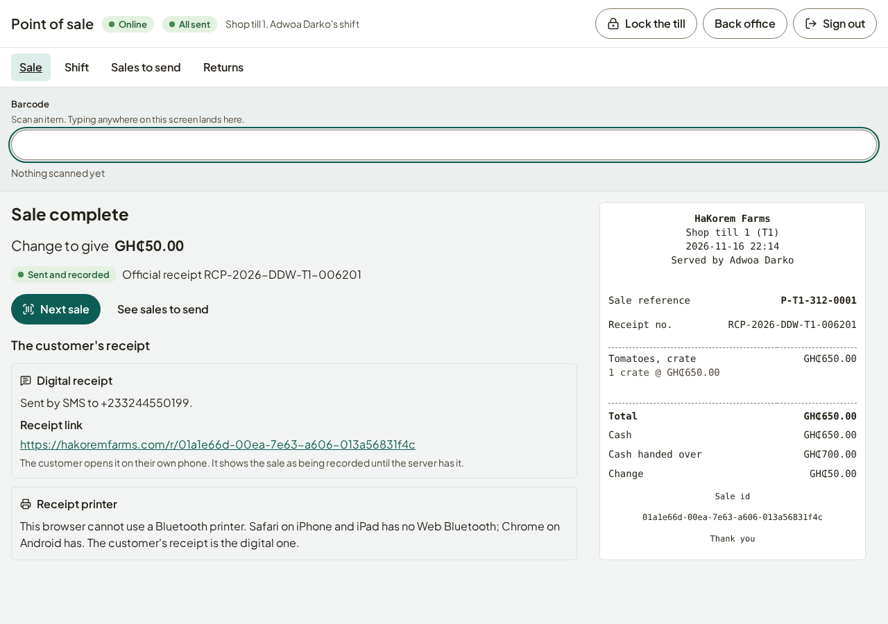

### Printed on a Bluetooth printer

Phone, 360 px: 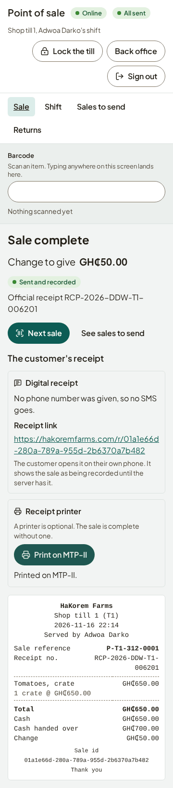

Desktop, 1280 px: 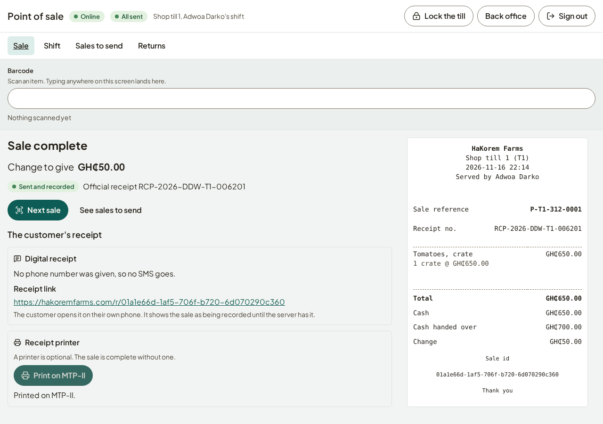

## Moved from the mock to the real API

**None.** B9b is not built, and CI and e2e build against Prism.

## Contract requests added

**None new.** CR-032 and CR-033 are rewritten with their exact shapes (the verifier operation and policy, the verifier version on the two approvals; the receipt link template, the SMS outcome on the sync result, the public receipt read), which is what F10 is built against. CR-023, CR-027 to CR-029 and CR-031 to CR-033 are still open.

## Assumptions

A-F9-03 replaced (owner, ADR 0045; built here). A-F9-04 partly replaced. New:

- **A-F10-01:** the e2e and CI builds are built against CR-032 and CR-033 in their requested shapes; a deploy sets nothing (ADR 0046).
- **A-F10-02:** PBKDF2-SHA256, the lockout per person on the till, the idle lock, and a locked till opened only by the shift's cashier (ADR 0047).
- **A-F10-03:** no on-screen QR code until the owner decides on a dependency (Q-F10-01).
- **A-F10-04:** the storefront's receipt page is not built.

## Decisions recorded

- **ADR 0046** (proposed): build against a contract request behind `HK_REQUESTED_CONTRACT`, never by calling what the contract lacks.
- **ADR 0047** (proposed): check the till PIN on the device with PBKDF2, lock out per person, keep the approving verifier beside the record.
- **DEPLOYMENT.md section 5:** never set `HK_REQUESTED_CONTRACT` for a deployed console.

## Gates, each run on its own

| Check                                                               | Exit | Count                                                                                                                                                        |
| ------------------------------------------------------------------- | ---- | ------------------------------------------------------------------------------------------------------------------------------------------------------------ |
| `format:check`, `lint`, `typecheck`                                 | 0    |                                                                                                                                                              |
| `tokens:check`, `fonts:check`, `icons:check`, `sync-contract:check` | 0    |                                                                                                                                                              |
| `test:unit`                                                         | 0    | console 242 (was 214; 28 new: the PIN, the till's PIN paths, ESC/POS, Bluetooth, the switch), api-client 30 (was 28), ui 885, storefront 29, data 28, i18n 6 |
| `test:integration`                                                  | 0    | console 244 (was 242; the unverified tender and receipt phone, the witnessed drop, against the real Prism), storefront 13                                    |
| `test:a11y`                                                         | 0    | 314 stories, unchanged                                                                                                                                       |
| `build:console`, `build:storefront`                                 | 0    | (in `test:e2e`)                                                                                                                                              |
| `budget:console`                                                    | 0    | till 244.4 of 250 kB initial script (was 240.2), 73.8 kB in 29 chunks on demand; back office 276.8 of 300 kB                                                 |
| `test:e2e`, full runs                                               | 0    | two full runs in a row after the last fix, 274 of 274 in each (266 before F10), 4.9 minutes each. 8 new (the PIN and the receipt)                            |
| console screenshots (`@screenshots F10`)                            | 0    | 14 shots: 7 states at 1280 and 360 px                                                                                                                        |

### What the gates found, and what was done

- **The PIN field emptied when a check finished**, wiping digits typed while it ran, so a quick second try clicked a disabled button. It now empties as the PIN is taken. A cashier typing fast would have met it.
- **Sign-out waited on the store write before asking the server**, so a page that moved on at once stayed signed in (the manager's session survived into the cashier's sign-in). The two now start together.
- **The queue's copy button kept its old accessible name** after its words changed (axe, label-content-name-mismatch).
- **The till's initial load reached 248.4 of 250 kB.** The receipt panel (printer and encoder) and the lock screen now load on demand and are fetched with the till's other screens, so they open offline: 244.4 kB.
- **`formatMoney` took a bare `'document'`** where it wants `{ context: 'document' }`, and TypeScript let it through; the printed receipt read `GH₵`. Caught by the encoder's exact-line test.
- **The float-money guard caught `Math.floor`** in the QR command's length bytes; they are bit operations now.
- **Two specs leaned on examples 1.43.0 changed** (CR-030): fixed to the contract, above.
- **One full run lost a test to an error outside any test:** the fake's `route.fetch` still in flight when F5b's branch-scope test ended, so the worker's next test did not run. The fixture now unroutes with `ignoreErrors` when a test ends; two full runs after it, 274 of 274 each.

## For the owner

1. **A QR code library for the on-screen link (Q-F10-01).** The till shows the receipt link as text, and only a printer draws it as a QR. Allow a small QR encoder (`uqr` 0.1.3, MIT, no dependencies, loaded on demand with the receipt panel so the till's initial load does not grow)? Or should the till carry its own encoder, proved against a decoder in CI?
2. **ADR 0046 and ADR 0047 are proposed.** ADR 0046 is how "a local mock override shaped exactly as CR-0xx asks" was built: a build switch only the e2e and CI builds set. ADR 0047 picks PBKDF2 (Web Crypto has no Argon2), a lockout per person on the till, and an idle lock whose time is CR-032's to set. Confirm or correct.
3. **Who may open a locked till.** F10 lets only the shift's cashier's PIN open it; a supervisor cannot, and a locked-out cashier signs out (the queue stays). Should a supervisor's PIN also open it?

## Opening message for the next session

```text
Read CLAUDE.md, docs/SHARED_BRIEF.md and docs/sessions/F10-the-till-pin-and-the-digital-receipt.md. Read
ADR 0045, ADR 0046 and ADR 0047, and the owner's answers to "For the owner" in that report if they are there.

This session keeps building against the mock. It does not start the BUILD_PROMPT's F10 phase (the quote
builder, the request-for-quote form, wholesale accounts) until B9b has proved the till's sync contract
(owner, 2026-11-16).

1. pnpm sync-contract:github and read .contract-upstream/CONTRACT_CHANGELOG.md after 1.44.0. Answer what it
   changes, including CR-023 and CR-027 to CR-033. If B9b went live, take items 1 to 15 under "Which parts
   of the gate wait for B9b" in the F10 report one by one against the real API (never Prism), prove each
   with a test or record the defect, its cause and its side, and say which till operations moved from the
   mock. If CR-032 or CR-033 landed, delete its module from apps/console/src/requested/ and its id from
   HK_REQUESTED_CONTRACT, call the generated client, and keep the specs green (ADR 0046).
2. The customer's receipt page on the storefront (CR-033 item 3, A-F10-04): the page the till's link opens,
   server rendered and built for 3G, "being recorded" until the sale has synced, the sale reference beside
   the official number. Against the requested shape until it lands; decide first how the storefront's e2e
   answers a requested operation, and record it.
3. If the owner allowed a QR encoder (Q-F10-01): the receipt link as a QR code on the till's screen, loaded
   with the receipt panel, never in the till's initial load.
4. Keep "Which parts of the gate wait for B9b" current in the report.

If CR-028 landed, show the shop's phone and WhatsApp on live animal pages (owner, 2026-11-16).
```
